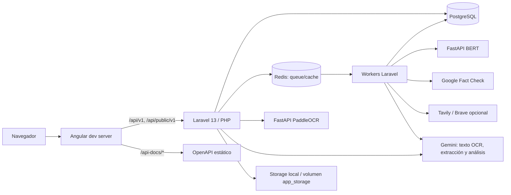
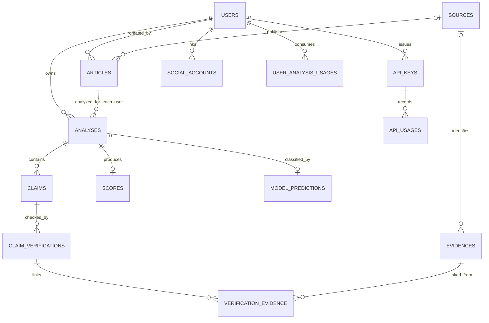

# FactNode — contexto técnico del proyecto

> Guía de referencia para desarrollo, depuración y refactorización. Describe el workspace
> observado, no una certificación de que todos los servicios externos o el despliegue estén
> operativos. Las afirmaciones sobre el estado se basan en archivos presentes; cuando el código
> no permite confirmarlas se indica **No determinado**.

## Alcance y cómo leer este documento

- Raíz del workspace: este directorio.
- Se inspeccionaron código, configuraciones, migraciones, pruebas, manifests, README, rutas,
  documentación OpenAPI, Docker/Compose, scripts y workflows.
- No se inspeccionó `.env` ni se copian valores secretos. Para configuración se usaron
  [`.env.example`](.env.example) y los
  archivos `config/*.php`.
- Las versiones marcadas **resueltas** se leyeron de `composer.lock` y
  [`frontend/package-lock.json`](frontend/package-lock.json); las versiones Python proceden de
  `requirements.txt` y Dockerfiles. Los requisitos con operadores `>=` no equivalen a una versión
  resuelta.
- Este documento refleja los archivos presentes al momento del análisis; no necesariamente
  coincide con una versión desplegada.

## 1. Resumen general

### Propósito

FactNode recibe una noticia como URL, texto pegado o captura; identifica afirmaciones
contrastables, busca verificaciones editoriales y evidencias web, y presenta un informe
explicable con puntaje, cobertura, veredicto, fuentes y razonamiento. El objetivo expresado por
la aplicación es ayudar a contrastar información, no sustituir el criterio del lector. La
descripción funcional está en [`README.md`](README.md), la UI en
[`frontend/src/app/pages/home.ts`](frontend/src/app/pages/home.ts) y la lógica de puntaje en
[`app/Services/Scoring/CredibilityScoreService.php`](app/Services/Scoring/CredibilityScoreService.php).

### Usuarios objetivo

- **Inferido del producto:** personas que quieren evaluar una noticia y consultar la evidencia
  detrás de un resultado.
- **Inferido de la API:** aplicaciones o desarrolladores que envían noticias y consultan
  análisis mediante API keys.
- **No determinado:** no se encontró una definición formal de personas usuarias, sectores,
  requisitos de accesibilidad medidos ni un documento de producto vigente. Revisar
  [`README.md`](README.md), [`public/api-docs/openapi.yaml`](public/api-docs/openapi.yaml) y el
  backlog o documentación de producto que mantenga el equipo.

### Estado observado

| Área | Estado observable en el workspace | Lo que no se puede concluir |
|---|---|---|
| Ingesta URL/texto e informes de análisis | Implementados en controladores, servicios, jobs, recursos y pruebas | Cobertura de producción y éxito con sitios web reales: **No determinado** |
| Análisis asíncrono por afirmación, búsqueda, fact-check, puntaje y reporte | Pipeline implementado; hay pruebas unitarias y de feature | Exactitud estadística del veredicto: **No determinado**; no se encontró corpus etiquetado |
| Cuentas, Sanctum, Google Identity, preferencias, cuotas y borrado | Endpoints y lógica implementados; los tokens de sesión tienen vencimiento y rotación; API keys son independientes | Uso real, políticas comerciales o escalamiento: **No determinado** |
| Frontend Angular | SPA pública y autenticada, documentación de API keys, preferencias y pruebas automatizadas axe | Pruebas manuales de usabilidad/accesibilidad con personas: **No determinado** |
| OCR | PaddleOCR local extrae líneas; Gemini organiza las líneas de texto antes de la ingesta | Calidad en capturas variadas: **No determinado**; Gemini no recibe la imagen |
| Microservicio BERT | Servicio de clasificación Python, carga un modelo Hugging Face | Calidad/calibración del modelo en el corpus del proyecto: **No determinado** |
| CI | Hay un workflow para validar backend y frontend | Que la última ejecución haya pasado: **No determinado** |
| Despliegue | No se incluye configuración de despliegue o aprovisionamiento en este repositorio | Infraestructura externa y proceso operativo: **No determinado** |
| Funcionalidad futura | No hay rutas visibles para restablecer contraseña o verificar email | Roadmap vigente y prioridades: **No determinado**; revisar backlog del equipo |

El README afirma que no hay métricas propias de precisión/recall y enumera limitaciones y
trabajo futuro; esas afirmaciones deben volver a comprobarse frente a datos y ejecución real,
que no se encuentran en el código inspeccionado.

## 2. Stack tecnológico

### Versiones y dependencias principales

| Componente | Versión/requisito declarado | Versión bloqueada o base de imagen | Evidencia |
|---|---|---|---|
| PHP | `>=8.4.1 <9.0` | CI usa PHP 8.4 | [`composer.json`](composer.json), [CI](.github/workflows/ci.yml) |
| Laravel | `^13.17` | `v13.38.0` | [`composer.json`](composer.json), [`composer.lock`](composer.lock) |
| Laravel Sanctum | `^4.3` | `v4.3.3` | Ídem |
| Predis | `^3.6` | `v3.6.0` | Ídem |
| Symfony DomCrawler | `^8.1` | `v8.1.5` | Ídem |
| Laravel DomPDF | `^3.1` | `v3.1.2` | Ídem |
| PHPUnit / Pint | `^12.5.12` / `^1.27` | `12.5.33` / `v1.30.5` | [`composer.json`](composer.json), [`composer.lock`](composer.lock) |
| Angular | `^21.2.0` | Angular packages `21.2.25`; CLI y build `21.2.27` | [`frontend/package.json`](frontend/package.json), [`frontend/package-lock.json`](frontend/package-lock.json) |
| TypeScript / RxJS | `~5.9.2` / `~7.8.0` | `5.9.3` / `7.8.2` | [`frontend/package-lock.json`](frontend/package-lock.json) |
| Node / npm | CI usa Node 24; `packageManager` declara `npm@11.1.0` | — | [frontend package](frontend/package.json), [CI](.github/workflows/ci.yml) |
| Python | Imagen base `python:3.11-slim` en ambos servicios | Dependencias resueltas no están bloqueadas por un lockfile Python | [Dockerfile OCR](ocr_service/Dockerfile), [Dockerfile ML](ml_service/Dockerfile) |
| OCR | `paddleocr==3.7.0`, `paddlepaddle==3.3.1`, FastAPI `0.115.0`, Uvicorn `0.30.1` | NumPy, Pillow y Pydantic usan rangos; no hay lockfile | [`ocr_service/requirements.txt`](ocr_service/requirements.txt) |
| Clasificador ML | Transformers `4.44.2`, Torch `2.4.1`, FastAPI `0.115.0`, Uvicorn `0.30.1` | La imagen instala Torch CPU explícitamente | [`ml_service/requirements.txt`](ml_service/requirements.txt), [`ml_service/Dockerfile`](ml_service/Dockerfile) |
| Persistencia local/CI | PostgreSQL 16 | `postgres:16-alpine` | [`docker-compose.yml`](docker-compose.yml), [CI](.github/workflows/ci.yml) |
| Colas | Redis 7; Laravel Queue y batches | `redis:7-alpine` | [`docker-compose.yml`](docker-compose.yml), [`config/queue.php`](config/queue.php) |

Dependencias directas adicionales PHP: `laravel/tinker` (resuelta `v3.0.2`), Faker
(`v1.24.1`), Mockery (`1.6.15`) y Collision (`v8.9.5`). Frontend de pruebas/build:
Vitest `4.1.12`, jsdom `28.1.0`, Prettier `3.9.10`. Los valores exactos están en los
lockfiles enlazados arriba.

### APIs y servicios externos

| Servicio | Propósito | Configuración y uso |
|---|---|---|
| Google Gemini | Extracción estructurada de claims, síntesis final del analista y organización de texto OCR | `GEMINI_API_KEY*`, `GEMINI_MODEL`, modelos de respaldo y timeouts; integración HTTP en `app/Services/AI/Providers/`, `app/Services/AI/Providers/GeminiAnalystProvider.php` y `app/Services/OCR/GeminiImageTextClassifier.php` |
| OpenAI | Respaldo opcional para extracción de claims si el proveedor primario da rate limit | `OPENAI_API_KEY`, modelo y timeout; `app/Services/AI/Providers/OpenAiProvider.php` |
| Google Fact Check Tools API | Búsqueda de revisiones editoriales publicadas | `GOOGLE_FACT_CHECK_*`; `app/Services/FactCheck/GoogleFactCheckProvider.php` |
| Tavily y Brave Search | Búsqueda secundaria; Tavily es configurable y Brave es opcional/desactivado por defecto | `TAVILY_*`, `BRAVE_*`, `SEARCH_PROVIDER_*`; `app/Services/Search/` |
| Google Identity Services | El navegador obtiene un ID token y Laravel verifica su firma/claims; no hay redirección OAuth ni persistencia de la credencial | `GOOGLE_CLIENT_ID` y `google/auth`; `app/Services/Auth/` |
| Hugging Face | Descarga del modelo BERT configurado | Modelo predeterminado `Juanillaberia/spanish-fake-news-classifier`; `ml_service/app/main.py` |
| Fuentes web | IBM Plex Sans, Space Grotesk y Atkinson Hyperlegible se sirven desde archivos locales; no se carga Google Fonts | [`frontend/src/styles.css`](frontend/src/styles.css), `frontend/public/fonts/` |

El OCR de PaddleOCR corre localmente en el microservicio. En el flujo vigente, Laravel envía
**solo las líneas de texto OCR numeradas** a Gemini: no envía imagen, cajas ni coordenadas.
Véanse [`ImageOCRService.php`](app/Services/OCR/ImageOCRService.php),
[`GeminiImageTextClassifier.php`](app/Services/OCR/GeminiImageTextClassifier.php) y
[`OcrController.php`](app/Http/Controllers/Api/OcrController.php).

## 3. Arquitectura

### Estilo y límites

- Backend Laravel organizado en capas convencionales: HTTP (controllers, `FormRequest`,
  resources), aplicación/orquestación (`Actions`, jobs), servicios de dominio, interfaces de
  proveedores, Eloquent y persistencia. No es una arquitectura hexagonal estricta: servicios
  usan directamente Facades Laravel, Eloquent e HTTP.
- Dos microservicios FastAPI independientes: BERT para clasificación auxiliar y PaddleOCR para
  transcripción de imágenes. Laravel invoca ambos por HTTP interno.
- Frontend Angular SPA separado del backend; el proxy del servidor Angular reenvía las
  solicitudes API durante el desarrollo local.
- La mayoría del análisis largo se procesa en jobs sobre Redis; la subida OCR se procesa de
  forma síncrona durante la petición.

### Diagrama de componentes



### Comunicación y límites de confianza

1. El navegador opera la SPA; Angular usa rutas relativas `/api/v1` y envía las credenciales
   de sesión correspondientes. En desarrollo, el proxy de Angular reenvía `/api` y `/api-docs`
   a `127.0.0.1:8000`
   ([`frontend/proxy.conf.json`](frontend/proxy.conf.json)).
2. Laravel valida la entrada, crea recursos con Eloquent y responde mediante
   `JsonResource`.
3. `StartAnalysis` crea o recupera la combinación noticia/usuario y despacha
   `AnalyzeArticleJob` por Redis.
4. Los workers ejecutan etapas paralelas y guardan resultados en PostgreSQL. Integraciones
   externas se encapsulan principalmente detrás de contracts enlazados en
   [`AppServiceProvider.php`](app/Providers/AppServiceProvider.php).
5. OCR: Laravel pasa la imagen al servicio local PaddleOCR; a Gemini pasa únicamente el texto
   detectado; luego conserva la imagen subida en el filesystem local configurado y registra su
   ruta/hash en metadatos.
6. `docker-compose.yml` aporta dependencias locales (PostgreSQL, Redis, BERT y OCR); Laravel y
   Angular se ejecutan con sus herramientas de desarrollo. No se incluye topología de producción.

## 4. Estructura de carpetas

Se omiten dependencias y artefactos generados/locales como `.git/`, `vendor/`, `node_modules/`,
`.venv/`, `frontend/dist/`, `frontend/.angular/` y contenido variable de `storage/`.

```text
.
├── .github/workflows/         Validación CI
├── app/
│   ├── Actions/               Casos de aplicación, p. ej. StartAnalysis
│   ├── Console/Commands/      Comandos Artisan propios (plan de API key)
│   ├── Contracts/             Interfaces para proveedores AI, búsqueda y fact-check
│   ├── DTO/                    DTOs de analista, búsqueda, scoring y fuente
│   ├── Exceptions/             Excepciones de proveedores AI
│   ├── Http/
│   │   ├── Controllers/Api/   Adaptadores HTTP para auth, artículos, análisis, etc.
│   │   ├── Middleware/        API key y normalización de JSON Unicode
│   │   ├── Requests/          Validación de entrada
│   │   └── Resources/         Contrato de serialización JSON
│   ├── Jobs/                  Etapas asíncronas del análisis
│   ├── Models/                Entidades Eloquent
│   ├── Policies/              Propiedad y autorización de artículos/análisis
│   ├── Providers/             Binding de interfaces y comandos de desarrollo
│   └── Services/
│       ├── AI/                 Gemini/OpenAI/BERT, circuit breaker, DTOs
│       ├── Article/            Extracción HTML, normalización e ingesta
│       ├── FactCheck/          Google Fact Check y normalización de ratings
│       ├── OCR/                Cliente PaddleOCR y clasificador textual Gemini
│       ├── Report/             Modelo de informe JSON/PDF
│       ├── Scoring/            Cálculo determinista de resultado
│       ├── Search/             Proveedores, persistencia y política de dominios
│       ├── Source/             Evaluación de dominio y perfil histórico
│       └── Verification/       Extracción/normalización/persistencia de claims
├── bootstrap/                  Arranque Laravel y registro de middleware/rutas
├── config/                     Configuración Laravel, IA, proveedores, scoring y planes
├── database/
│   ├── factories/              Datos de prueba/fábricas
│   ├── migrations/             Esquema y evolución de base de datos
│   └── seeders/                Seeder de usuario de prueba
├── frontend/
│   ├── public/                 Assets estáticos de Angular
│   └── src/app/
│       ├── core/               Auth, API, modelos, interceptors y accesibilidad
│       └── pages/              Pantallas Angular lazy-loaded
├── ml_service/                 FastAPI/PyTorch/Transformers para clasificación BERT
├── ocr_service/                FastAPI/PaddleOCR y pruebas unittest
├── public/
│   ├── api-docs/openapi.yaml   OpenAPI de la API pública
│   └── index.php               Entrada HTTP de Laravel
├── resources/views/reports/    Plantilla Blade del PDF de análisis
├── routes/                     Rutas API, web y comandos
├── scripts/
│   ├── start.ps1               Arranque local integrado de Windows
│   └── php-dev-ini/uploads.ini Límites PHP de subida en desarrollo
├── tests/
│   ├── Feature/                Contratos HTTP y flujos de extremo a extremo
│   └── Unit/                   Servicios, providers, jobs y normalizadores
├── docker-compose.yml          Dependencias locales (Postgres, Redis, ML, OCR)
├── composer.json / lock        Dependencias y comandos PHP
├── README.md                   Guía funcional/operativa existente
├── requests.http               Ejemplos manuales de llamadas API
└── PROJECT_CONTEXT.md          Este documento
```

Archivos de navegación/frontend importantes: [`frontend/src/app/app.routes.ts`](frontend/src/app/app.routes.ts),
[`frontend/src/app/app.ts`](frontend/src/app/app.ts), [`frontend/src/app/core/api.service.ts`](frontend/src/app/core/api.service.ts),
[`frontend/src/app/core/auth.service.ts`](frontend/src/app/core/auth.service.ts) y
[`frontend/src/app/core/models.ts`](frontend/src/app/core/models.ts).

## 5. Módulos y funcionalidades

### 5.1 Autenticación, cuenta y propiedad

**Responsabilidad:** registro/login local y con Google, rotación y revocación de tokens,
preferencias de perfil, vinculación/desvinculación de Google, cuotas y borrado reautenticado de
cuenta. Los tokens de sesión Sanctum se emiten con `expires_at` (7 días por defecto,
`AUTH_TOKEN_TTL_MINUTES`) y se limpian con `sanctum:prune-expired --hours=24`; las API keys
públicas no usan esa expiración. `AuthService` guarda el token y datos del usuario en
`localStorage`, sincroniza la rotación entre pestañas y limpia la sesión ante un 401 no
recuperable. Rutas Angular protegidas por `authGuard` y `guestGuard`.

**Archivos:** [`AuthController.php`](app/Http/Controllers/Api/AuthController.php),
[`AuthService`](frontend/src/app/core/auth.service.ts),
[`http.ts`](frontend/src/app/core/http.ts), [`app.routes.ts`](frontend/src/app/app.routes.ts),
[`ArticlePolicy.php`](app/Policies/ArticlePolicy.php), [`AnalysisPolicy.php`](app/Policies/AnalysisPolicy.php).

**Dependencias/flujo:** Laravel `auth:sanctum` resuelve usuario; el verificador Google valida
firma, `iss`, `aud`, `exp` y `email_verified`. Las políticas comprueban propiedad o
visibilidad; la deduplicación de artículos se limita al usuario. Las sesiones tienen límites
por IP y correo, cuotas diarias/concurrentes y preferencias de tema, tipografía, contraste,
movimiento, interlineado y densidad.

### 5.2 Ingesta de noticias

**Responsabilidad:** aceptar URL, texto o una imagen OCR; construir una entidad Article y
reutilizar artículos que ya tengan la misma URL canónica o huella de contenido.

- URL: `StoreArticleRequest` valida URL pública básica; `ArticleExtractionService` descarga HTML
  con timeout y extrae JSON-LD, Open Graph, título, descripción, cuerpo, autor, fecha, idioma,
  canonical URL y metadatos. `DomainNormalizer` obtiene host y quita `www.`.
- Texto: acepta JSON con `content` y opcionales `title`/`author_name`; también adapta
  `text/plain` al campo `content`. Texto pegado y OCR reciben un título de reserva si no se
  envía uno; la extracción de claims de Gemini puede sugerir título en esa misma llamada.
  `title_source` distingue `extracted`, `user`, `ai` y `fallback`. El título no se concatena al
  contenido que analiza el pipeline ni al `content_hash`.
- Imagen: valida JPG/JPEG/PNG/WebP hasta 5 MiB; PaddleOCR devuelve texto, cajas y scores. El
  cliente PHP normaliza líneas y envía a Gemini solo `{id,text}`. Gemini clasifica las líneas
  como `news`, `image_text`, `profile` o `other`; el artículo conserva `news` y `image_text`.
  El perfil/interfaz se guardan en metadatos; se conserva la captura en `ocr-images` hasta la
  eliminación de cuenta, que también borra los archivos propios.

**Archivos:** [`ArticleController.php`](app/Http/Controllers/Api/ArticleController.php),
[`StoreArticleRequest.php`](app/Http/Requests/StoreArticleRequest.php),
[`StoreOcrRequest.php`](app/Http/Requests/StoreOcrRequest.php),
[`ArticleIngestionService.php`](app/Services/Article/ArticleIngestionService.php),
[`ArticleExtractionService.php`](app/Services/Article/ArticleExtractionService.php),
[`OcrController.php`](app/Http/Controllers/Api/OcrController.php),
[`ocr_service/app/main.py`](ocr_service/app/main.py).

### 5.3 Pipeline de análisis

**Responsabilidad:** analizar las afirmaciones de un Article y generar un resultado persistente
auditable.

1. `StartAnalysis` busca una fila por `article_id + user_id`; si falta, crea estado `pending`
   y envía `AnalyzeArticleJob`.
2. `AnalyzeArticleJob` marca `processing` y encola `ExtractClaimsJob`.
3. `ClaimExtractionService` valida artículo utilizable, construye prompt y JSON Schema, invoca
   provider y normaliza claims, entidades, fuentes y flags. Los claims se guardan con
   fingerprint y transacción.
4. `ExtractClaimsJob` encola `ClassifyArticleJob` y, por cada claim verificable,
   `VerifyClaimJob` y `SearchClaimEvidenceJob`, en un `Bus::batch` con fallos permitidos.
5. Fact-check y búsqueda consultan proveedores, normalizan, filtran y guardan
   `ClaimVerification`/`Evidence`. La asociación claim-verificación/evidencia pasa por
   `verification_evidence`.
6. Al terminar el batch, `FinalizeAnalysisJob` evalúa la fuente, pide síntesis opcional a Gemini,
   llama al score determinista y guarda `Score` y estado `completed`.
7. El frontend sondea `/status` y cuando termina obtiene AnalysisResource completo.

**Archivos:** [`StartAnalysis.php`](app/Actions/StartAnalysis.php),
[`AnalyzeArticleJob.php`](app/Jobs/AnalyzeArticleJob.php),
[`ExtractClaimsJob.php`](app/Jobs/ExtractClaimsJob.php),
[`ClaimExtractionService.php`](app/Services/Verification/ClaimExtractionService.php),
[`ClassifyArticleJob.php`](app/Jobs/ClassifyArticleJob.php),
[`VerifyClaimJob.php`](app/Jobs/VerifyClaimJob.php),
[`SearchClaimEvidenceJob.php`](app/Jobs/SearchClaimEvidenceJob.php),
[`FinalizeAnalysisJob.php`](app/Jobs/FinalizeAnalysisJob.php).

### 5.4 Proveedores de IA y evaluación

- `AiProviderInterface` implementa extracción; `FallbackAiProvider` delega a Gemini y usa
  OpenAI solo ante rate limit si está activado.
- Gemini intenta claves/modelos configurados; `GeminiModelCircuit` guarda temporalmente
  modelos no disponibles en Cache.
- `ClassifierProviderInterface` apunta a `BertFakeNewsProvider`, que invoca `POST /classify`.
  Su salida `REAL`/`FAKE` es una señal de lenguaje auxiliar, no evidencia editorial.
- `AnalystProviderInterface` apunta a `GeminiAnalystProvider`, llamado al final con claims,
  verificaciones, evidencias y contexto de fuente. El job atrapa un fallo de síntesis para
  intentar el cálculo determinista sin esa síntesis.
- `CredibilityScoreService` calcula puntajes por claim, agrega señales y se abstiene si la
  cobertura no supera el mínimo configurado.

**Archivos:** [`AppServiceProvider.php`](app/Providers/AppServiceProvider.php),
[`FallbackAiProvider.php`](app/Services/AI/Providers/FallbackAiProvider.php),
[`GeminiProvider.php`](app/Services/AI/Providers/GeminiProvider.php),
[`GeminiAnalystService.php`](app/Services/AI/GeminiAnalystService.php),
[`GeminiAnalystProvider.php`](app/Services/AI/Providers/GeminiAnalystProvider.php),
[`BertFakeNewsProvider.php`](app/Services/AI/Providers/BertFakeNewsProvider.php),
[`CredibilityScoreService.php`](app/Services/Scoring/CredibilityScoreService.php).

### 5.5 Búsqueda, fact-check y política de fuentes

- `GoogleFactCheckProvider` consulta en español y normaliza ratings mediante
  `FactCheckRatingNormalizer`; consulta una segunda query compacta si la primera no produce
  rating utilizable.
- `SearchProviderManager` consulta proveedor primario y recurre al fallback si falla.
  `EvidenceSearchService` forma query, deduplica URLs, canonicaliza y persiste resultados.
- `SourceDomainPolicy` bloquea redes/plataformas configuradas, filtra resultados también tras
  proveedor y pone fuentes confiables primero; `SEARCH_TRUSTED_ONLY` puede restringirlas.
- `SourceAnalysisService` asigna tier/reputación por listas de dominios conocidas, reputación
  almacenada o heurísticas de TLD. `SourceProfileService` produce ranking basado en resultados
  FactNode.

**Archivos:** `app/Services/FactCheck/`, `app/Services/Search/` y
`app/Services/Source/`; configuración en [`fact_check.php`](config/fact_check.php) y
[`search.php`](config/search.php).

### 5.6 API pública, cuotas y consumo

`AuthenticateApiKey` busca `X-API-Key` (o bearer), compara SHA-256 con `api_keys.key_hash`,
rechaza revocadas, aplica rate limit por plan y coloca usuario/clave en la request. El endpoint
`POST /api/public/v1/analyses` ingiere URL/texto, limita análisis diarios, crea/reutiliza
análisis y contabiliza uso. `ApiKeyController` permite a una persona autenticada crear, listar y
revocar claves. El comando `php artisan apikeys:plan {id} {free|pro}` cambia el plan.

**Archivos:** [`AuthenticateApiKey.php`](app/Http/Middleware/AuthenticateApiKey.php),
[`ApiKey.php`](app/Models/ApiKey.php), [`ApiUsage.php`](app/Models/ApiUsage.php),
[`PublicAnalysisController.php`](app/Http/Controllers/Api/PublicAnalysisController.php),
[`ApiKeyController.php`](app/Http/Controllers/Api/ApiKeyController.php),
[`SetApiKeyPlan.php`](app/Console/Commands/SetApiKeyPlan.php).

### 5.7 Informes y perfil de fuentes

- `AnalysisReportBuilder` prepara un DTO/array compartido; ReportController entrega JSON como
  adjunto o genera PDF con DomPDF y `resources/views/reports/analysis.blade.php`.
- `SourceProfileService` consulta análisis completados por medio y calcula promedio,
  veredictos, muestra e histórico con prior de 5 observaciones.

### 5.8 Interfaz Angular

Rutas lazy-loaded en `frontend/src/app/app.routes.ts`: inicio/análisis nuevo, resultado,
historial, fuentes, API keys, documentación pública de API (`/documentacion-api`), privacidad,
preferencias, login y registro. `ApiService` mapea endpoints, `AuthService` gestiona sesión, y
`A11yService` persiste tema, escala tipográfica, contraste, movimiento, interlineado, densidad y
fuente en el navegador. La preferencia se carga antes del primer render mediante
`frontend/public/preferences-bootstrap.js`; Atkinson Hyperlegible se autoaloja. Los estilos de
componentes se mantienen en hojas compartidas o archivos `styleUrl`, además de
`frontend/src/styles.css`.

## 6. Modelo de datos

El esquema evoluciona mediante [`database/migrations/`](database/migrations/). El Compose local y
la etapa de migraciones de CI usan PostgreSQL; PHPUnit usa SQLite en memoria.

### Entidades de negocio

| Tabla / modelo | Campos principales | Relaciones y restricciones relevantes |
|---|---|---|
| `users` / User | `name`, `email`, `password` nullable, `email_verified_at`, `preferences` | `email` único; tiene análisis, artículos creados, API keys, tokens y cuentas sociales |
| `social_accounts` / SocialAccount | `user_id`, `provider`, `provider_user_id`, `email` | `provider + provider_user_id` único; FK a users |
| `user_analysis_usages` / UserAnalysisUsage | `user_id`, `date`, `analyses` | unique `(user_id, date)`; contador diario para cuota de sesión |
| `sources` / Source | `name`, `domain`, `url`, `type`, `country`, `language`, `description`, `reputation_score` | `domain` único; una fuente tiene muchos artículos y evidencias |
| `articles` / Article | `source_id`, `created_by`, `url`, `canonical_url`, `title`, `title_source`, `description`, `content`, `author_name`, `published_at`, `language`, `content_hash`, `metadata` | `title_source`: `extracted/user/ai/fallback`; `source_id` y `created_by` nullable; deduplicación de contenido se limita al usuario |
| `analyses` / Analysis | `article_id`, `user_id`, `status`, provider/model, `algorithm_version`, scores, `final_verdict`, timestamps, `error` | article/user FKs nullable según las migraciones; unicidad compuesta `article_id + user_id`; cascading al borrar article, user se hace null |
| `claims` / Claim | `analysis_id`, `text`, `type`, `importance`, `verifiable`, `context`, `fingerprint`, `metadata` y campos históricos `verdict`, `confidence`, `position` | FK cascading a analyses; unique `(analysis_id, fingerprint)`; índices por `type`, `verifiable` y `fingerprint` |
| `evidences` / Evidence | `source_id`, `url`, `title`, `content`, `snippet`, `published_at`, `retrieved_at`, `content_hash`, `similarity`, `metadata` | `source_id` nullable; `url` única; `content_hash` indexado |
| `claim_verifications` / ClaimVerification | `claim_id`, `relation`, `status`, `fingerprint`, `provider`, `query_used`, publicador, URL/título de fact-check, ratings, idioma, fecha, confianza, relevancia, `metadata` | FK cascading a claims; `fingerprint` única; varias evidencias por pivote |
| `verification_evidence` | `claim_verification_id`, `evidence_id`, timestamps | Pivot con ambas FKs cascading; PK compuesta y además un unique sobre el mismo par |
| `scores` / Score | `analysis_id`, componentes de puntaje, `final_score`, `algorithm_version`, `metadata` | `analysis_id` único y FK cascading; máximo un score por análisis |
| `model_predictions` / ModelPrediction | `analysis_id`, label, confianza/probabilidad, proveedor/modelo/versión, `metadata` | `analysis_id` único y FK cascading; máximo una predicción por análisis |
| `api_keys` / ApiKey | `user_id`, nombre, prefijo, hash, plan, uso, revocación | `key_hash` único; user FK cascading |
| `api_usages` / ApiUsage | `api_key_id`, `date`, `requests`, `analyses`, `errors` | FK cascading; unique `(api_key_id, date)` |

`reputation_score` de Source se interpreta como escala 0–1 por
[`SourceAnalysisService.php`](app/Services/Source/SourceAnalysisService.php); puntuaciones de
análisis se presentan en escala 0–100. `scores.metadata` almacena desglose, señales y
evaluaciones de claims; el API Resource lo publica estructuradamente.

### Tablas de infraestructura Laravel

Las migraciones base crean `password_reset_tokens`, `sessions`, `cache`, `cache_locks`, `jobs`,
`job_batches`, `failed_jobs` y `migrations`. Se usan según configuración de sesión, cache,
colas y registro de fallos; la existencia de tablas para reset no implica que haya flujo HTTP
de restablecimiento de contraseña.

### Diagrama ER



### Evolución de esquema destacable

- Migrations `2026_08_25_*`: fuentes, artículos, análisis, claims, evidencias, verificaciones,
  scores y pivot.
- `2026_08_27_*`: limpieza de análisis duplicados y unicidad inicial por artículo.
- `2026_09_01_*`/`2026_09_02_*`: extracción estructurada, predicciones, verificaciones y
  metadatos de score, fingerprints/URLs únicas.
- `2026_09_22_*`: URL de artículo nullable, necesario para texto pegado.
- `2026_10_20_*`: tokens Sanctum, ownership por usuario y tablas de API keys/consumo. La
  unicidad de análisis se cambia a `(article_id,user_id)`.
- `2026_10_21_*`: metadatos de análisis y alcance por usuario de la deduplicación de artículos.
- `2026_10_24_*`: contraseña nullable y cuentas sociales; uso diario de análisis por usuario;
  `articles.title_source` y preferencias de usuario.

Al cambiar el esquema, verificar `up()` y `down()` en la migración nueva y actualizar factories,
resources y pruebas afectadas.

## 7. API, rutas y endpoints

Base de usuario: `/api/v1`. Las rutas de usuario requieren autenticación mediante token de
Sanctum, salvo registro e inicio de sesión. Base de API pública: `/api/public/v1`, protegida por
`X-API-Key`. Los límites indicados se definen en [`routes/api.php`](routes/api.php).

### API de usuario

| Método y ruta | Controller/handler | Parámetros de entrada | Auth | Respuesta esperada |
|---|---|---|---|---|
| `POST /auth/register` | `AuthController::register` | `name`, `email`, `password`, `password_confirmation` | No; 10/min | `201`, usuario + token; errores de validación `422` |
| `POST /auth/login` | `AuthController::login` | `email`, `password` | No; 10/min | `200`, usuario + token; credenciales inválidas `422` |
| `POST /auth/google` | `AuthController::google` | `credential` (ID token GIS) | No; 10/min | `200/201`; `409 account_exists` no vincula una cuenta local automáticamente |
| `GET /auth/me` | `AuthController::me` | — | Sanctum | `200 {data: user}` |
| `POST /auth/logout` | `AuthController::logout` | — | Sanctum | Revoca token actual; mensaje JSON |
| `POST /auth/refresh` | `AuthController::refresh` | — | Sanctum; 10/min por IP y correo | Rota el token; entrega nuevo `token` y `expires_at` |
| `POST /auth/logout-all` | `AuthController::logoutAll` | — | Sanctum | Revoca todos los tokens |
| `PUT /auth/password` | `AuthController::changePassword` | `current_password`, `password`, `password_confirmation` | Sanctum | Cambia contraseña y revoca los demás tokens |
| `PUT /auth/preferences` | `AuthController::updatePreferences` | objeto `preferences` con valores permitidos | Sanctum | Persiste preferencias; `422 invalid_preferences` |
| `GET /auth/quota` | `AnalysisQuotaController` | — | Sanctum | Uso, restante, concurrencia y `resets_at` |
| `POST /auth/google/link` · `DELETE /auth/google` | `AuthController` | credencial Google para vincular | Sanctum | Vincula o desvincula si queda otro método de acceso |
| `DELETE /account` | `AccountController::destroy` | contraseña actual o credencial Google reciente | Sanctum; 5/min | Elimina cuenta y datos propios después de reautenticar |
| `GET /api-keys` | `ApiKeyController::index` | — | Sanctum | `data` claves activas, límites y uso de 30 días |
| `POST /api-keys` | `ApiKeyController::store` | `name` (≤80) | Sanctum; 10/min | `201`; clave plana solo en esta respuesta; límite de 5 claves activas |
| `DELETE /api-keys/{apiKey}` | `ApiKeyController::destroy` | ID de clave | Sanctum | Marca `revoked_at`; `403` si pertenece a otra persona |
| `GET /sources` | `SourceController::index` | — | Sanctum; 60/min | Ranking de perfil histórico de fuentes |
| `GET /sources/{source}/profile` | `SourceController::show` | ID source | Sanctum; 60/min | Perfil histórico de la fuente |
| `GET /articles` | `ArticleController::index` | `search`, `domain`, `per_page` (1–100), paginación page/cursor | Sanctum; 60/min | Colección paginada de artículos visibles al usuario |
| `POST /articles` | `ArticleController::store` | `url` o `content` (30–65 000), `title`, `author_name`; admite `text/plain` | Sanctum; 10/min | `201 ArticleResource`; errores de validación/proceso |
| `POST /articles/ocr` | `OcrController::store` | multipart `image`, JPG/JPEG/PNG/WebP, ≤5 MiB | Sanctum; 10/min | `201 ArticleResource`; OCR/clasificación falla con `503`, entrada/texto insuficiente `422` |
| `GET /articles/{article}` | `ArticleController::show` | ID article | Sanctum + `ArticlePolicy` | `200 ArticleResource`; no visible `403` |
| `PATCH /articles/{article}` | `ArticleController::updateTitle` | ID article, `title` ≤150 | Propietario; 20/min | Actualiza título y asigna `title_source=user` |
| `POST /articles/{article}/analyze` | `ArticleAnalysisController::store` | ID article, cuerpo vacío | Sanctum + política; 20/min | `202` nuevo o `200` ya existente; `AnalysisResource` |
| `GET /analyses` | `AnalysisController::index` | `status`, `final_verdict`, `article_id`, `per_page`, cursor/page | Sanctum; 60/min | Lista paginada de análisis del usuario |
| `GET /analyses/{analysis}` | `AnalysisController::show` | ID analysis | Sanctum + `AnalysisPolicy`; 60/min | AnalysisResource con artículo, score, claims, verificaciones y evidencias |
| `GET /analyses/{analysis}/status` | `AnalysisController::status` | ID analysis | Sanctum + política; 120/min | Estado, etapa, progreso derivado, duración y error |
| `POST /analyses/{analysis}/retry` | `AnalysisController::retry` | ID analysis | Sanctum + política; 20/min | Reencola con `202`; `409` si ya está procesando |
| `GET /analyses/{analysis}/report/json` | `ReportController::json` | ID analysis | Sanctum + política; 30/min | Archivo JSON; `409` si no completado o sin score |
| `GET /analyses/{analysis}/report/pdf` | `ReportController::pdf` | ID analysis | Sanctum + política; 20/min | Descarga PDF; `409` si no completado o sin score |

La mayoría de los errores de validación Laravel se representan como `422`; errores de
autorización como `403`; APIs no autenticadas como `401`. Las respuestas finales se serializan
por `app/Http/Resources/`. `AnalysisStatusResource` marca progreso aproximado a partir de
claims, predicción y score, no de un porcentaje medido del trabajo.

### API pública con API key

El contrato estático completo es [`public/api-docs/openapi.yaml`](public/api-docs/openapi.yaml).

| Método y ruta | Handler | Parámetros | Auth | Respuesta |
|---|---|---|---|---|
| `POST /api/public/v1/analyses` | `PublicAnalysisController::store` | `url` o `content`, opcional `title`/`author_name` | API key activa | `202` nueva / `200` reutilizada; `429` rate/daily cap; `422` inválida |
| `GET /api/public/v1/analyses/{analysis}` | `AnalysisController::show` | ID | API key; autorización al usuario dueño de la key | AnalysisResource |
| `GET /api/public/v1/analyses/{analysis}/status` | `AnalysisController::status` | ID | API key | Estado/progreso |
| `GET /api/public/v1/analyses/{analysis}/report/json` | `ReportController::json` | ID | API key | Informe JSON o `409` hasta completar |
| `GET /api/public/v1/analyses/{analysis}/report/pdf` | `ReportController::pdf` | ID | API key | Informe PDF o `409` hasta completar |
| `GET /api/public/v1/usage` | `PublicAnalysisController::usage` | — | API key | Plan, límites y consumo de hoy |

Las rutas `/`, `/up` y `/api-docs/openapi.yaml` son endpoints de estado/documentación fuera
del grupo anterior: `/` devuelve nombre/docs/health JSON; `/up` es el health endpoint de Laravel;
OpenAPI es un archivo estático en `public/api-docs/`.

La API de sesión y cuenta se documenta en este README, no en OpenAPI. La API pública no añadió
rutas en la Fase 4; el contrato OpenAPI incluye la procedencia del título en el artículo de la
respuesta del informe (`title_source`: `extracted`, `user`, `ai` o `fallback`).

## 8. Flujos principales de extremo a extremo

### A. Crear y analizar una noticia desde URL

1. Angular envía `POST /api/v1/articles` con URL.
2. Laravel valida URL en `StoreArticleRequest`, descarga la página con
   `ArticleExtractionService` y extrae metadatos HTML.
3. `ArticleIngestionService` normaliza dominio, crea/reutiliza Source y Article.
4. Angular solicita `POST /articles/{id}/analyze`; política controla visibilidad.
5. `StartAnalysis` crea/reutiliza análisis del usuario y despacha a Redis; responde antes del
   procesamiento completo.
6. Jobs extraen claims, clasifican texto con BERT, consultan Google Fact Check y búsqueda web
   por claim, persisten resultados, sintetizan y calculan el score.
7. UI sondea estado y descarga detalles/informe cuando finaliza.

### B. Crear y analizar texto pegado

1. Cliente envía JSON con `content` o cuerpo `text/plain`.
2. `StoreArticleRequest` valida texto de 30 a 65 000 caracteres.
3. Ingesta calcula SHA-256 del contenido, deriva título cuando falta y crea artículo sin Source.
4. Desde aquí usa el mismo pipeline asincrónico del flujo URL.

### C. Analizar una captura

1. UI sube imagen ≤5 MiB a `POST /articles/ocr`.
2. `ImageOCRService` codifica la imagen en base64 y la envía a `POST /ocr` del servicio local.
   PaddleOCR decodifica/valida, detecta texto y ordena líneas por caja vertical/horizontal.
3. Laravel entrega solo líneas `{id,text}` a `GeminiImageTextClassifier`; Gemini devuelve
   categoría por línea y `headline_line_id`. Se valida que todos los IDs sean únicos y que
   titular/categorías tengan valores permitidos.
4. Se combina texto `news` + `image_text`; `profile` y `other` se guardan como metadatos. Si
   clasificación o validación falla, no se ingiere el artículo.
5. Laravel guarda captura, ruta y SHA-256; el endpoint devuelve ArticleResource y Angular inicia
   el análisis normal.

La clasificación no tiene contexto visual ni geometría en el prompt; distinguir contenido
integrado a una fotografía del cuerpo del post depende del texto y puede fallar.

### D. Iniciar análisis con API pública

1. Middleware `api.key` valida hash, revocación y límite por minuto.
2. El controlador cuenta análisis diarios de esa clave y valida cuota del plan.
3. Ingesta noticia como propietario asociado a la clave y llama `StartAnalysis`.
4. Incrementa la cuota si creó análisis nuevo; el middleware incrementa consumo/errores de la
   petición y actualiza `last_used_at`.
5. Cliente consulta status, detalle o reporte con la misma clave.

### E. Reintentar / emitir informe

1. Reintento autorizado limpia estado/errores/tiempos y vuelve a despachar `AnalyzeArticleJob`;
   se bloquea con `409` si `processing`.
2. Huellas/índices únicos y guardas de jobs evitan duplicar trabajo ya persistido.
3. Cuando finaliza, `ReportController` verifica `completed` y existencia de Score; crea payload
   con `AnalysisReportBuilder`; entrega JSON descargable o PDF generado desde Blade.

## 9. Patrones de diseño y convenciones

| Patrón / convención | Aplicación |
|---|---|
| Strategy / Dependency inversion | Interfaces en `app/Contracts/`, bindings en `AppServiceProvider`; proveedores reemplazables y testeables |
| Fallback | `FallbackAiProvider` (AI) y `SearchProviderManager` (búsqueda) |
| Circuit breaker | `GeminiModelCircuit`: cachea indisponibilidad temporal por modelo |
| Pipeline con jobs y batch | Una etapa por job; fan-out por claim; `Bus::batch(...)->allowFailures()` |
| Idempotencia | Huellas de claims/verificaciones, unique URL de evidencia, unique análisis por artículo/usuario y score/predicción por análisis |
| DTO + Resource | DTO entre servicios y Resources como contrato externo; evitar serializar modelos directamente |
| Laravel | PSR-4 `App\` → `app/`; controladores `*Controller`, jobs `*Job`, modelos singular, migraciones timestamp |
| Angular | Standalone components, routing lazy, signals, `HttpClient`/RxJS, tests `.spec.ts` |
| FastAPI | Pydantic request/response models, handlers síncronos para inferencia y endpoints `/health` |

**Formato:** `.editorconfig` define UTF-8, LF, espacios y newline final; migraciones PHP usan el
estilo de Laravel/Pint. CI exige `vendor/bin/pint --test`. No se configura ejecución de Prettier
en el workflow actual.

**Errores y observabilidad:** `AiProviderException` distingue HTTP, rate limit, timeout,
configuración, cuota y JSON inválido; servicios/jobs escriben contexto de IDs, proveedor y
errores con `Log`. `UnescapeJsonUnicode` conserva tildes/Unicode en respuestas JSON. Algunos
controladores convierten excepciones de ingesta a mensaje genérico.

**Pruebas:** PHPUnit con `RefreshDatabase`, SQLite en memoria y `Http::fake`; estructura
`tests/Unit` y `tests/Feature`. OCR Python usa `unittest` en
`ocr_service/tests/test_main.py`. Las pruebas Angular se ejecutan con el builder de Angular y
Vitest. No se encontró suite de pruebas para `ml_service`.

## 10. Configuración y entorno

### Archivos

- Desarrollo: [`.env.example`](.env.example); configurar `APP_KEY` con `php artisan key:generate`.
- Configuración central: `config/ai.php`, `config/search.php`, `config/fact_check.php`,
  `config/scoring.php`, `config/plans.php`, `config/database.php`, `config/queue.php`,
  `config/auth.php`, `config/sanctum.php`.
- El archivo `.env` real no se leyó.

### Variables de entorno

Los nombres de variables sensibles se documentan como nombres, nunca valores. Para defaults y
valores exactos, consultar los archivos de ejemplo y `config/`.

| Grupo | Variables | Propósito |
|---|---|---|
| Aplicación | `APP_NAME`, `APP_ENV`, `APP_KEY`, `APP_DEBUG`, `APP_URL`, `APP_LOCALE`, `APP_FALLBACK_LOCALE`, `APP_FAKER_LOCALE`, `APP_MAINTENANCE_DRIVER`, `BCRYPT_ROUNDS` | Identidad, entorno, cifrado, URL, locale, mantenimiento y costo de hash |
| Logs | `LOG_CHANNEL`, `LOG_STACK`, `LOG_DEPRECATIONS_CHANNEL`, `LOG_LEVEL` | Canal y nivel de logging |
| Base de datos | `DB_CONNECTION`, `DB_HOST`, `DB_PORT`, `DB_DATABASE`, `DB_USERNAME`, `DB_PASSWORD` | Driver y acceso a DB; sólo `DB_CONNECTION` está activo en `.env.example`, las otras variables están comentadas |
| Cache/cola/sesión | `CACHE_STORE`, `QUEUE_CONNECTION`, `QUEUE_DEV_WORKERS`, `SESSION_DRIVER`, `SESSION_LIFETIME`, `SESSION_ENCRYPT`, `SESSION_PATH`, `SESSION_DOMAIN`, `BROADCAST_CONNECTION`, `FILESYSTEM_DISK` | Almacenamiento Laravel, workers de desarrollo y sesión |
| Redis | `REDIS_CLIENT`, `REDIS_HOST`, `REDIS_PASSWORD`, `REDIS_PORT` | Cliente y acceso local Redis |
| Correo | `MAIL_MAILER`, `MAIL_SCHEME`, `MAIL_HOST`, `MAIL_PORT`, `MAIL_USERNAME`, `MAIL_PASSWORD`, `MAIL_FROM_ADDRESS`, `MAIL_FROM_NAME` | Transporte de mail configurado por Laravel; no hay flujo de correo propio visible |
| AWS opcional | `AWS_ACCESS_KEY_ID`, `AWS_SECRET_ACCESS_KEY`, `AWS_DEFAULT_REGION`, `AWS_BUCKET`, `AWS_USE_PATH_STYLE_ENDPOINT` | Credenciales usadas solo si se configura un servicio AWS en los adaptadores Laravel |
| Selección AI | `AI_PROVIDER`, `AI_FALLBACK_ENABLED`, `AI_FALLBACK_PROVIDER`, `AI_PROVIDER_TIMEOUT`, `AI_RATE_LIMIT_BACKOFF`, `CLAIM_EXTRACTION_PROMPT_VERSION` | Provider primario/respaldo, timeout/backoff y versión del prompt |
| Gemini | `GEMINI_API_KEY`, `GEMINI_API_KEY_2`, `GEMINI_API_KEY_3`, `GEMINI_API_BASE_URL`, `GEMINI_MODEL`, `GEMINI_FALLBACK_MODELS`, `GEMINI_TEMPERATURE`, `GEMINI_EXTRACTION_TIMEOUT`, `GEMINI_ANALYST_TIMEOUT`, `GEMINI_OCR_TIMEOUT`, `GEMINI_UNAVAILABLE_COOLDOWN`, `GEMINI_EXTRACTION_THINKING_LEVEL` | Credenciales rotables, endpoint, modelos, temperatura, timeout por uso y cooldown |
| OpenAI | `OPENAI_API_KEY`, `OPENAI_API_BASE_URL`, `OPENAI_MODEL`, `OPENAI_TEMPERATURE`, `OPENAI_TIMEOUT` | Provider de respaldo de extracción |
| OCR | `OCR_SERVICE_PORT`, `OCR_SERVICE_URL`, `OCR_TIMEOUT`, `OCR_CONNECT_TIMEOUT` | Puerto Docker local, URL del FastAPI OCR y límites HTTP |
| BERT | `ML_SERVICE_PORT`, `BERT_SERVICE_URL`, `BERT_TIMEOUT`, `BERT_CONNECT_TIMEOUT`, `BERT_CLASSIFIER_MODEL`, `BERT_CLASSIFIER_VERSION`, `CLASSIFIER_PROVIDER` | Servicio y modelo de clasificación; las tres últimas se admiten en `config/ai.php`, aunque no todas aparecen en `.env.example` |
| Fact Check | `GOOGLE_FACT_CHECK_ENABLED`, `GOOGLE_FACT_CHECK_API_KEY`, `GOOGLE_FACT_CHECK_API_BASE_URL`, `GOOGLE_FACT_CHECK_TIMEOUT`, `GOOGLE_FACT_CHECK_CONNECT_TIMEOUT` | Habilitación, clave y timeouts de Google Fact Check |
| Búsqueda general | `SEARCH_PROVIDER_ENABLED`, `SEARCH_PROVIDER_DEFAULT`, `SEARCH_PROVIDER_FALLBACK`, `SEARCH_PROVIDER_TIMEOUT`, `SEARCH_PROVIDER_CONNECT_TIMEOUT`, `SEARCH_PROVIDER_MAX_RESULTS`, `SEARCH_FETCH_RESULTS`, `SEARCH_EVIDENCE_PER_CLAIM`, `SEARCH_TRUSTED_ONLY`, `SEARCH_EXTRA_BLOCKED_DOMAINS`, `SEARCH_EXTRA_TRUSTED_DOMAINS` | Activación, orden de proveedores, cantidad, filtros y política de dominios |
| Tavily / Brave | `TAVILY_SEARCH_ENABLED`, `TAVILY_API_KEY`, `TAVILY_API_BASE_URL`, `TAVILY_TIMEOUT`, `TAVILY_CONNECT_TIMEOUT`, `TAVILY_MAX_RESULTS`; `BRAVE_SEARCH_ENABLED`, `BRAVE_API_KEY`, `BRAVE_API_BASE_URL`, `BRAVE_TIMEOUT`, `BRAVE_CONNECT_TIMEOUT`, `BRAVE_MAX_RESULTS` | Tavily se habilita con su configuración; Brave es opcional y desactivado por defecto, por lo que su clave puede permanecer vacía |
| Scoring | `SCORING_ALGORITHM_VERSION`, `SCORING_WEIGHT_EVIDENCE`, `SCORING_WEIGHT_LANGUAGE`, `SCORING_WEIGHT_SOURCE`, `SCORING_WEIGHT_CORROBORATION`, `SCORING_WEIGHT_INDEPENDENCE`, `SCORING_WEIGHT_CONSISTENCY`, `SCORING_WEIGHT_TRANSPARENCY`, `SCORING_MIN_EVIDENCE_COVERAGE`, `SCORING_CREDIBLE_COVERAGE`, `SCORING_CREDIBLE_FACT_CHECK_COVERAGE`, `SCORING_PROBABLY_CREDIBLE_COVERAGE`, `SCORING_PROBABLY_MISLEADING_COVERAGE`, `SCORING_FALSE_FACT_CHECK_COVERAGE`, `SCORING_FALSE_MAX_SCORE`, `SCORING_CENTRAL_CLAIM_WEIGHT`, `SCORING_CENTRAL_CLAIM_MARGIN`, `SCORING_UNVERIFIED_SECONDARY_WEIGHT`, `CLAIM_EXTRACTION_MAX_CLAIMS` | Versión, pesos, thresholds, centralidad, claim cap y condiciones de abstención |
| Planes API | `PLAN_FREE_PER_MINUTE`, `PLAN_FREE_ANALYSES_PER_DAY`, `PLAN_PRO_PER_MINUTE`, `PLAN_PRO_ANALYSES_PER_DAY` | Cuotas editables por plan |
| Tokens/config de autenticación | `AUTH_TOKEN_TTL_MINUTES`, `SANCTUM_STATEFUL_DOMAINS`, `SANCTUM_TOKEN_PREFIX`, `AUTH_GUARD`, `AUTH_MODEL`, `AUTH_PASSWORD_BROKER`, `AUTH_PASSWORD_TIMEOUT` | TTL de tokens de sesión configurable (10 080 minutos por defecto); API keys no se ven afectadas |
| Cuotas de cuentas web | `ANALYSES_PER_DAY`, `ANALYSES_CONCURRENT_PER_USER` | Límite diario y simultáneo por usuario |
| Google Identity | `GOOGLE_CLIENT_ID` en backend y `googleClientId` en el environment Angular | Mismo Client ID OAuth público para validar la audiencia del ID token |

Laravel también admite variables estándar opcionales para drivers alternativos (SQS,
Beanstalkd, Memcached, S3, SMTP, etc.). No son requisitos operativos de este proyecto tal como
está configurado.

### Instalación y desarrollo

Requisitos observables: PHP 8.4.1+, Composer, Node 24/npm compatible, Docker Desktop y
PowerShell en Windows. Para ejecutar microservicios Python fuera de Docker, se necesita Python
3.11 y dependencias de `ml_service/requirements.txt` u `ocr_service/requirements.txt`.

```powershell
# Dependencias PHP
composer install

# Entorno si no existe
Copy-Item .env.example .env
php artisan key:generate

# Dependencias/build Angular
npm --prefix frontend install --legacy-peer-deps
npm --prefix frontend run build

# Infraestructura local
docker compose up -d

# Esquema
php artisan migrate

# API, workers y Angular en desarrollo
composer dev
# UI: http://localhost:4200; API: http://127.0.0.1:8000
```

`composer start` ejecuta [`scripts/start.ps1`](scripts/start.ps1): verifica Docker/PHP/Composer/npm,
crea `.env` si falta, instala dependencias faltantes, levanta servicios Compose con `--wait`,
migra y ejecuta `php artisan dev`. No sustituye la configuración de credenciales externas.

`composer dev` ejecuta Laravel `artisan dev`; `AppServiceProvider` registra trabajadores de cola
(cantidad configurable) y `npm --prefix frontend start`. No instala ni migra dependencias por sí
solo.

Comandos de prueba principales:

```powershell
php artisan test
vendor\bin\pint --test
npm --prefix frontend test -- --watch=false
Set-Location ocr_service
python -m unittest discover -s tests
```

La forma exacta de invocar Vitest también está en
[`frontend/package.json`](frontend/package.json). CI ejecuta `npx ng test --watch=false`.

### Configuración local

Los valores PostgreSQL de `.env.example` coinciden con los defaults del servicio `postgres` en
`docker-compose.yml`. `REDIS_CLIENT=predis` usa la dependencia incluida en Composer y se conecta
al servicio Redis local.

### Alcance operativo

El repositorio contiene configuración de desarrollo local y CI, pero no incluye aprovisionamiento
ni despliegue de producción. La configuración de infraestructura externa debe definirse cuando
se seleccione y documente una plataforma de despliegue.

## 11. Seguridad y autenticación

- **Sanctum:** los tokens de sesión llevan `expires_at`; `AUTH_TOKEN_TTL_MINUTES` configura el
  TTL (10 080 minutos por defecto) y `sanctum.expiration` aplica el mismo límite. Refresh rota
  el token, logout revoca el actual, logout-all revoca todos y cambio de contraseña revoca los
  demás. El scheduler poda tokens vencidos con `sanctum:prune-expired --hours=24`. Las API keys
  públicas son independientes.
- **Google Identity:** `GoogleIdentityClaimsService` valida firma y claims `iss`, `aud`, `exp`
  y `email_verified`; el correo local existente no se vincula automáticamente. El ID token se
  recibe en JSON y no se almacena. El borrado de cuenta exige contraseña actual o ID token de
  Google recién emitido (ventana configurada de 5 minutos).
- **Cuotas de sesión:** `ANALYSES_PER_DAY` y `ANALYSES_CONCURRENT_PER_USER`; `GET /auth/quota`
  informa uso, cupo restante, análisis activos y hora de reinicio. No sustituyen las cuotas por
  plan de API keys.
- **Preferencias:** el backend valida listas permitidas para tema, escala de texto, contraste,
  movimiento, interlineado, densidad y fuente.
- **Almacenamiento frontend:** token persistido en `localStorage` bajo `factnode.token`; reduce
  dependencia de cookies/CSRF, pero aumenta impacto de un XSS. Evaluar alternativas antes de
  endurecer este límite.
- **Propiedad:** `ArticlePolicy`, `AnalysisPolicy`, scopes y filtrado de índices. API keys
  autentican como la cuenta dueña.
- **API keys:** prefijo `fn_live_`, aleatoriedad generada en `ApiKey::issue`, persistencia SHA-256
  y clave plana mostrada una vez; revocación con timestamp.
- **Validación:** FormRequests; URL rechaza `localhost`, `.local` e IP literal privada/reservada;
  texto y uploads limitados. Esa mitigación no resuelve DNS antes de la descarga, por lo que no
  evita todos los escenarios SSRF/redirect rebinding.
- **Rate limiting:** login, registro y refresh tienen límites por IP y correo normalizado;
  API pública limita por key y plan y devuelve `Retry-After`/`X-RateLimit-*`. En despliegue
  detrás de proxy hay que configurar `trustProxies` para identificar la IP del cliente.
- **Secrets:** configuración desde environment. No almacenar secretos en commits ni documentación.
- **CORS:** no se encontró `config/cors.php` ni configuración CORS explícita. El diseño actual
  usa el proxy de Angular en desarrollo; para frontend en otro origen revisar `bootstrap/app.php`,
  agregar/configurar CORS y revisar `SANCTUM_STATEFUL_DOMAINS` si se cambia a autenticación stateful.
- **Privacidad de OCR:** la imagen se envía a PaddleOCR local y se conserva en storage; a Gemini
  solo se manda el texto OCR. Esto está implementado en el flujo actual.
- **Borrado:** `AccountDeletionService` elimina tokens, claves, análisis, artículos propios y
  archivos de captura referenciados; no se observó una política de purga automática de análisis.

## 12. Deuda técnica y problemas conocidos

Los puntos siguientes son observaciones estáticas para orientar futuras tareas; no significan
que todos se hayan reproducido en un entorno productivo.

1. **Clasificación OCR exclusivamente textual.** Gemini no recibe imagen ni coordenadas, así
    que no puede inferir visualmente qué texto está incrustado en el gráfico frente al pie del
    post. Errores de lectura/clasificación requieren UX o lógica de validación adicional.
2. **Pivot con restricción duplicada.** `verification_evidence` declara primary key y unique
    con exactamente las mismas columnas. Es redundante y puede añadir índice extra. Revisar
    migration antes de alterarla, por compatibilidad SQLite/Postgres.
3. **No hay reset/verificación de email implementados.** Hay tablas Laravel, pero no rutas
    propias en [`routes/api.php`](routes/api.php) ni flujos en `AuthController`.
4. **Planes sin pagos.** `free`/`pro` existen; el cambio de plan se hace con comando Artisan,
    no hay suscripción/pasarela de pagos en código visible.
5. **Sin expiración absoluta de sesión.** El TTL del token se aplica a cada emisión/rotación,
    pero no hay un máximo de vida desde el login.
6. **Pendientes de despliegue:** `trustProxies`, cliente OAuth/orígenes JavaScript/CSP,
    ejecución de migraciones, HTTPS, almacenamiento persistente para capturas y supervisión de
    workers no están configurados en este repositorio.
7. **Accesibilidad manual no verificada.** Hay pruebas axe automatizadas; teclado, zoom al
    200 % y lector de pantalla aún requieren comprobación manual.
8. **Calidad/exactitud no medible desde el repositorio.** No se encontró corpus de referencia,
    benchmark ni calibración estadística. La confianza se calcula como heurística, no probabilidad
    calibrada.

La búsqueda estática de `TODO`/`FIXME` en los módulos principales no encontró marcadores activos.
Esto no implica que no existan tareas abiertas en issues o backlog.

## 13. Decisiones de diseño relevantes

Las razones siguientes se infieren de `README.md`, comentarios y código; el historial de commits
no se revisó.

| Decisión | Razón documentada/observable | Puntos de extensión |
|---|---|---|
| Pipeline asincrónico por jobs | Latencia de proveedores externos y verificación paralela por claim | `app/Jobs/`, `StartAnalysis`, queue Redis |
| Redis para workers/batches | Cola concurrente con `retry_after` alto para llamadas lentas | `config/queue.php`, `AppServiceProvider` |
| Separar claim extraction, BERT, fact-check, web search, finalización | Aislar fallas y probar etapas; batches toleran fallos parciales | Jobs individuales + tests unitarios |
| Puntaje determinista con evidencia por claim | Auditoría y abstención cuando evidencia insuficiente; LLM no decide score final | `CredibilityScoreService`, `config/scoring.php` |
| Fact-check sobre búsqueda general; BERT peso menor | Revisión editorial directa tiene mayor fuerza que señal de estilo | Normalizador y pesos de scoring |
| JSON Schema para outputs Gemini/OpenAI | Facilita validar respuesta y rechazar campos/claims inválidos | Providers y `ClaimExtractionService` |
| BERT y PaddleOCR aislados en Python | Mantener librerías pesadas de ML fuera de PHP | `ml_service/`, `ocr_service/` |
| PaddleOCR local | Evita depender de un proveedor OCR remoto; los modelos se descargan y cachean en volumen | `ocr_service/Dockerfile`, `docker-compose.yml` |
| Gemini recibe OCR textual sin imagen | Clasifica líneas antes de analizar sin entregar la captura al proveedor | `GeminiImageTextClassifier`; salida puede perder contexto visual |
| Una fila de análisis por usuario y artículo | No duplicar análisis propios y permitir aislamiento de cuenta | unique `(article_id,user_id)` |
| API keys separadas de Sanctum | Integraciones servidor-servidor, revocación, planes y métricas por clave | `ApiKey`, middleware y `ApiUsage` |
| Angular separado de API Laravel | UI standalone y endpoints reutilizables por SPA/API pública | `frontend/`, proxy de desarrollo y API routes |

## 14. Glosario

| Término | Significado en FactNode |
|---|---|
| Claim / afirmación | Proposición identificada dentro de una noticia; se guarda en `claims` |
| Verificable | Claim factual que puede contrastarse con fuentes; opiniones y predicciones no se incluyen en el veredicto |
| Evidencia | Resultado web persistido con URL, título/snippet y metadatos; no equivale automáticamente a prueba |
| Fact-check | Revisión editorial indexada por Google Fact Check Tools; rating se normaliza a categorías del sistema |
| Cobertura de evidencia | Fracción ponderada de claims con soporte/evaluación disponible |
| Abstención / inconcluso | No emitir una afirmación de veracidad cuando cobertura no alcanza el mínimo |
| BERT | Clasificador español que ofrece señal auxiliar `REAL`/`FAKE`; no verifica por sí solo |
| OCR | Reconocimiento óptico de caracteres; aquí PaddleOCR local devuelve líneas, caja y score |
| `image_text` | Categoría asignada por Gemini a una línea OCR que el modelo interpreta como texto informativo incrustado en imagen |
| Fingerprint | Huella normalizada usada para deduplicar claims y verificaciones |
| Circuit breaker | Cache temporal que evita insistir en modelos Gemini marcados no disponibles |
| Batch | Conjunto de jobs paralelos con callbacks de finalización |
| API key | Credencial `fn_live_...` de API pública, guardada como hash y asociada a plan/uso |
| Source | Dominio/medio editorial de la noticia, no necesariamente una fuente de evidencia |
| Score | Resultado determinista, componentes y metadata explicativa de un Analysis |
| `inconclusive` | Estado/veredicto de abstención; no significa que la noticia sea falsa |

## 15. Guía para futuras tareas

### Añadir o cambiar un endpoint

1. Declarar método, middleware y throttle en [`routes/api.php`](routes/api.php).
2. Validar body/path mediante clase `app/Http/Requests/*Request.php`.
3. Mantener Controller como adaptador; delegar reglas en Service/Action.
4. Para propiedad de recursos, revisar policies y scopes antes de cargar/serializar.
5. Añadir o ajustar `Http/Resources/*Resource.php` para controlar contrato y eager-loading.
6. Añadir prueba feature en `tests/Feature/Api/`; usar `actingAsUser`, `RefreshDatabase` y
   `Http::fake` para HTTP externo.
7. Si es ruta pública, actualizar [`public/api-docs/openapi.yaml`](public/api-docs/openapi.yaml)
   y comprobar middleware API key/cuotas.

### Añadir tabla/campo

1. Crear migración timestamp nueva en `database/migrations/`; no editar una migración ya
   desplegada.
2. Definir FK, `onDelete`, índices y unique acorde a ownership/idempotencia.
3. Actualizar Model fillable/casts/relations/scopes, factories y seeder cuando aplique.
4. Actualizar Resources/DTOs/API/frontend models si el campo sale por API.
5. Añadir pruebas de migración/relación/constraints y ejecutar en PostgreSQL y SQLite, ya que
   CI migra en PostgreSQL pero suite de tests usa SQLite.

### Añadir proveedor o servicio externo

1. Definir/usar un contrato en `app/Contracts/`.
2. Implementar proveedor en subcarpeta apropiada, centralizar URL/credenciales/timeouts en
   `config/` y documentar variables sin valores secretos en `.env.example`.
3. Registrar binding en `AppServiceProvider`; diferenciar errores de conexión, 429, 402/403,
   respuesta inválida y fallo permanente.
4. Escribir pruebas de contrato con `Http::fake`, validando request/payload, respuesta y
   fallback; evitar llamada real desde CI.
5. Si se persiste salida, agregar constraints/idempotencia y reflejar datos en resources.

### Cambiar el análisis/scoring

1. Para extracción/normalización: `ClaimExtractionService` y DTOs AI; preservar tipos permitidos,
   validación y fingerprints.
2. Para fuentes: `EvidenceSearchService`, `FactCheckService` y `SourceDomainPolicy`; mantener
   bloqueo/filtro local también si proveedor acepta `exclude_domains`.
3. Para score/umbrales: [`CredibilityScoreService.php`](app/Services/Scoring/CredibilityScoreService.php)
   y [`config/scoring.php`](config/scoring.php); guardar algoritmo/versiones y actualizar pruebas
   específicas, documentación e informe.
4. Para jobs: mantener ownership de la etapa, reintentos/backoff, `failed()` y comportamiento
   del batch coherentes; revisar si cualquier fallo debe abortar o permitir completar.

### Cambiar frontend

- Rutas y guards: [`frontend/src/app/app.routes.ts`](frontend/src/app/app.routes.ts).
- API y DTOs compartidos: [`frontend/src/app/core/api.service.ts`](frontend/src/app/core/api.service.ts),
  [`frontend/src/app/core/models.ts`](frontend/src/app/core/models.ts).
- Sesión/interceptor/errores: `frontend/src/app/core/auth.service.ts` y `http.ts`.
- Preferencias/accesibilidad: `a11y.service.ts`, `pages/preferences.ts` y `frontend/src/styles.css`.
- Componentes standalone y pruebas cercanas `.spec.ts`; mantener labels/estados accesibles y
  persistencia local alineada con `A11yService`.

### Cambiar OCR o autenticación del servicio OCR

- Contrato HTTP/salida OCR: [`ocr_service/app/main.py`](ocr_service/app/main.py) y
  [`ocr_service/tests/test_main.py`](ocr_service/tests/test_main.py).
- Cliente Laravel y validación: `ImageOCRService`, `StoreOcrRequest`, `OcrController`.
- Clasificación textual Gemini: `GeminiImageTextClassifier`; no añadir datos de imagen al
  payload sin decisión explícita de privacidad/producto.
- Probar flujo endpoint con `tests/Feature/Api/OcrApiTest.php` y Python con `unittest`.

### Cambiar operación local y CI

- Desarrollo Windows: `scripts/start.ps1`, `docker-compose.yml`, `scripts/php-dev-ini/uploads.ini`.
- CI: `.github/workflows/ci.yml`.
- Al cambiar servicios/puertos, actualizar simultáneamente Compose, URLs de `.env.example`,
  healthchecks y documentación.
- Este repositorio no provisiona ni despliega infraestructura de producción.

### Reglas para no romper arquitectura

- No hacer llamadas de red ni operaciones lentas dentro de request si pertenecen al pipeline
  asíncrono; excepción actual: OCR e ingesta HTML síncronos.
- No permitir que la IA asigne el score final ni tratar búsqueda/BERT como prueba directa.
- No exponer modelos Eloquent completos ni errores/credenciales de proveedores.
- Mantener autorización al consultar IDs; no confiar en filtrado del frontend.
- Preservar idempotencia bajo reintentos/concurrencia con constraints de DB además de guardas
  de aplicación.
- Conservar mensajes de salida OCR sin la imagen al invocar el clasificador Gemini actual.
- No editar `.env` ni secretos en PR/documentación; cambiar `.env.example` con nombres/defaults
  seguros.
- Actualizar README y OpenAPI cuando cambie el comportamiento o contrato externo.
- Antes de cerrar un cambio, correr la suite mínima afectada, Pint y build/tests Angular/Python
  que correspondan; recordar que CI actual no cubre los tests de Python.
