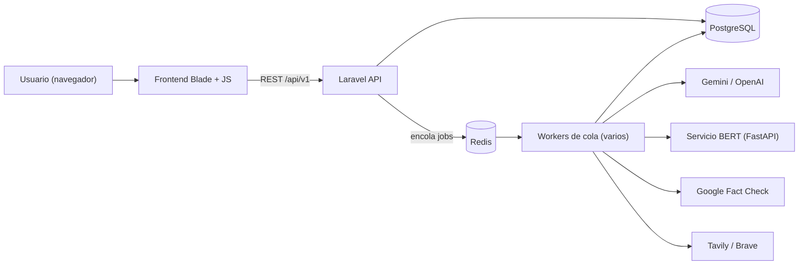
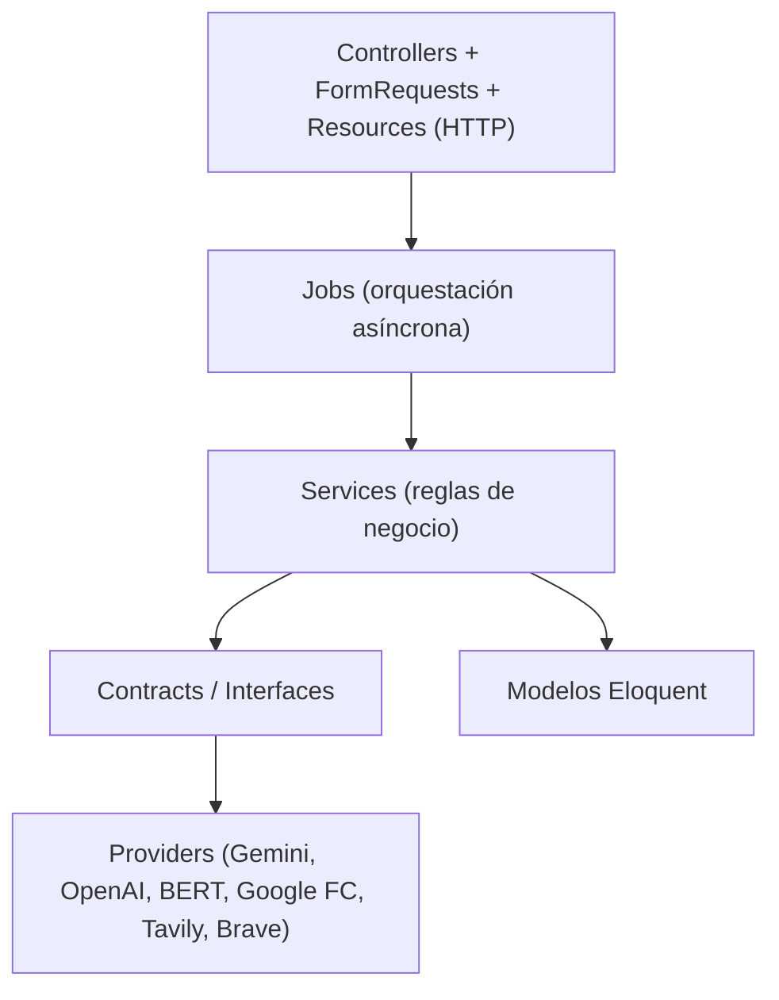
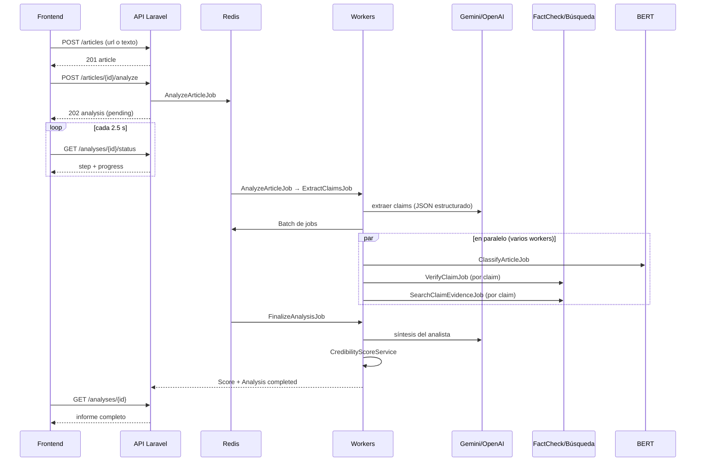
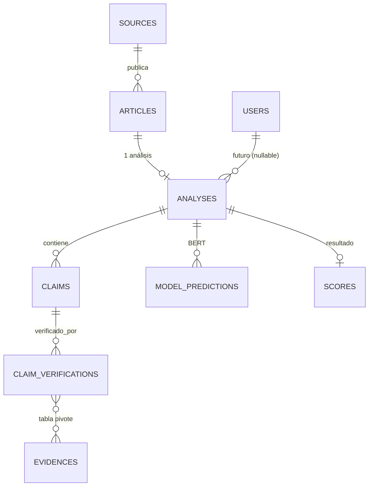

# FactNode – Detector de veracidad de noticias (backend + interfaz web)

> **Contrasta. Evidencia. Decide.**

FactNode recibe una noticia (URL o texto pegado), extrae sus afirmaciones, las contrasta con
verificadores de datos y búsquedas web, y devuelve un **informe explicable**: puntaje de
credibilidad (0–100), veredicto, evaluación de veracidad en lenguaje natural y las fuentes
usadas para cada afirmación.

Este documento sirve como guía de sustentación: explica **qué hace** el sistema, **cómo
está construido**, **por qué se tomaron las decisiones** y **cuáles son sus límites**.

---

## Tabla de contenido

1. [Qué problema resuelve y qué NO hace](#1-qué-problema-resuelve-y-qué-no-hace)
2. [Stack tecnológico](#2-stack-tecnológico)
3. [Arquitectura](#3-arquitectura)
4. [Flujo completo de un análisis](#4-flujo-completo-de-un-análisis)
5. [Modelo de datos](#5-modelo-de-datos)
6. [Algoritmo de puntaje y veredicto (v1.2.0)](#6-algoritmo-de-puntaje-y-veredicto-v120)
7. [Integraciones externas y resiliencia](#7-integraciones-externas-y-resiliencia)
8. [Política de fuentes de evidencia](#8-política-de-fuentes-de-evidencia)
9. [Colas, concurrencia e idempotencia](#9-colas-concurrencia-e-idempotencia)
10. [API REST](#10-api-rest)
11. [Seguridad](#11-seguridad)
12. [Interfaz web](#12-interfaz-web)
13. [Estructura del código](#13-estructura-del-código)
14. [Configuración (variables de entorno)](#14-configuración-variables-de-entorno)
15. [Instalación y ejecución](#15-instalación-y-ejecución)
16. [Pruebas y CI](#16-pruebas-y-ci)
17. [Decisiones de diseño y alternativas descartadas](#17-decisiones-de-diseño-y-alternativas-descartadas)
18. [Limitaciones conocidas y trabajo futuro](#18-limitaciones-conocidas-y-trabajo-futuro)
19. [Preguntas frecuentes de sustentación](#19-preguntas-frecuentes-de-sustentación)
20. [Glosario](#20-glosario)

---

## 1. Qué problema resuelve y qué NO hace

**Problema:** una persona lee una noticia y quiere saber si es confiable, sin tener que
buscar manualmente cada dato.

**Qué hace el sistema**

- Acepta una noticia por **URL** (extrae título, cuerpo, autor, fecha, medio) o por **texto
  pegado**.
- Divide la noticia en **afirmaciones (claims)** verificables y no verificables.
- Para cada afirmación verificable consulta **verificadores de datos** (Google Fact Check
  Tools) y **búsquedas web** (Tavily, con Brave de respaldo).
- Un **analista basado en Gemini** evalúa cada afirmación únicamente con la evidencia
  encontrada y redacta una síntesis.
- Un **clasificador BERT** en español aporta una señal auxiliar de estilo/lenguaje.
- Un **servicio de puntaje determinista** combina todas las señales en un puntaje, un
  veredicto y una explicación.

**Qué NO hace (importante al sustentar)**

- No "adivina" la verdad con un modelo: **BERT y los resultados de búsqueda nunca son prueba**
  de un hecho; son pistas o señales auxiliares.
- No entrena ni reentrena modelos con cada petición.
- No garantiza una exactitud medida: **no existe aún un conjunto etiquetado** para calcular
  precisión/recall (ver [limitaciones](#18-limitaciones-conocidas-y-trabajo-futuro)).
- Cuando no hay evidencia suficiente **se abstiene** (`inconclusive`) en vez de forzar un
  veredicto.

---

## 2. Stack tecnológico

| Capa | Tecnología | Por qué |
|---|---|---|
| Lenguaje / framework | PHP ≥ 8.4, **Laravel 13** | Colas, ORM, validación, recursos JSON y pruebas integrados |
| Base de datos | **PostgreSQL 16** (Docker) | Restricciones únicas y JSON; robusta para concurrencia |
| Colas / caché de jobs | **Redis 7** (Docker, cliente `predis`) | Procesamiento asíncrono y varios workers en paralelo |
| Caché de aplicación | Base de datos (`CACHE_STORE=database`) | Suficiente; se usa para el "circuit breaker" de modelos Gemini |
| IA generativa | **Google Gemini** (primario) y **OpenAI `gpt-4o-mini`** (respaldo en extracción) | Salida estructurada (JSON Schema) y alta disponibilidad con rotación de llaves y modelos |
| Clasificador | **BERT** `Juanillaberia/spanish-fake-news-classifier` en un microservicio **FastAPI** (Python, Docker) | Modelo específico para español, aislado del backend |
| Verificación | **Google Fact Check Tools API** | Revisiones editoriales reales con rating |
| Búsqueda web | **Tavily** (principal) y **Brave** (respaldo) | Resultados con snippets aptos para análisis |
| Extracción HTML | `symfony/dom-crawler` | Lee JSON-LD, Open Graph, metadatos y párrafos |
| Frontend | Blade + **Vite 8** + JS/CSS propios | Interfaz ligera con la identidad FactNode (Angular quedó diferido) |
| Pruebas | **PHPUnit 12**, SQLite en memoria | Rápidas y aisladas de servicios externos (`Http::fake`) |
| CI | GitHub Actions (PHP 8.4) | Ejecuta `php artisan test` en cada push/PR |

---

## 3. Arquitectura

### 3.1 Vista de componentes



### 3.2 Capas del backend



- **Controllers**: delgados; validan con `FormRequest`, delegan y responden con `Resource`.
- **Jobs**: cada etapa es un job independiente, reintentable e idempotente.
- **Services**: lógica de negocio (`ClaimExtractionService`, `FactCheckService`,
  `EvidenceSearchService`, `CredibilityScoreService`, `SourceAnalysisService`, …).
- **Contracts**: interfaces (`AiProviderInterface`, `ClassifierProviderInterface`,
  `AnalystProviderInterface`, `FactCheckProviderInterface`, `SearchProviderInterface`).
  `AppServiceProvider` las enlaza a su implementación; así se puede **cambiar de proveedor
  sin tocar la lógica** y simular proveedores en las pruebas (inversión de dependencias).
- **DTOs** (`App\DTO`, `Services\AI\DTO`): objetos inmutables entre capas, en lugar de arrays
  sueltos.

### 3.3 Patrones aplicados

| Patrón | Dónde | Para qué |
|---|---|---|
| Strategy / interfaz + binding | `Contracts/*` + `AppServiceProvider` | Intercambiar proveedores |
| Fallback chain | `FallbackAiProvider`, `SearchProviderManager` | Si el primario falla, usa el siguiente |
| Circuit breaker (ligero) | `GeminiModelCircuit` | Saltar modelos Gemini saturados durante 120 s |
| Batch + callbacks | `Bus::batch(...)->then(...)` | Esperar a todas las verificaciones y luego finalizar |
| Idempotencia | `fingerprint`, `createOrFirst`, comprobaciones al inicio de cada job | Reintentos y concurrencia sin duplicados |
| DTO / Resource | `Http/Resources/*` | Contrato JSON controlado (no se serializan modelos completos) |

---

## 4. Flujo completo de un análisis

### 4.1 Diagrama de secuencia



### 4.2 Paso a paso

1. **Ingesta** (`ArticleController@store` → `ArticleIngestionService`)
   - URL: `ArticleExtractionService` descarga el HTML (timeout 20 s) y extrae título,
     descripción, cuerpo, autor, fecha, idioma y metadatos. Prioriza **JSON-LD**, luego
     Open Graph/Twitter/meta y por último el HTML.
   - Texto: acepta JSON (`content`, `title`, `author_name`) o `Content-Type: text/plain`.
     Entre 30 y 65 000 caracteres.
   - Se crea/reutiliza el `Source` (dominio normalizado) y se **deduplica** el artículo por
     `canonical_url` o `content_hash` (SHA-256).
2. **Solicitud de análisis** (`ArticleAnalysisController@store`)
   - Hay **un solo análisis por artículo** (índice único `analyses.article_id`). Si ya existe,
     devuelve `200` con el existente; si no, crea uno `pending` y responde `202`.
3. **`AnalyzeArticleJob`**: marca `processing`, registra `started_at` y encola
   `ExtractClaimsJob`.
4. **`ExtractClaimsJob`**
   - Llama a Gemini (con `FallbackAiProvider`) pidiendo **salida estructurada** (JSON Schema):
     resumen, claims (texto, importancia 0–1, `verifiable`, tipo, contexto), entidades,
     fuentes citadas y señales de alerta.
   - `ClaimExtractionService` valida y normaliza (tipos permitidos, importancia en rango,
     deduplicación por huella `fingerprint`) y persiste los claims.
   - Crea un **batch**: `ClassifyArticleJob` + por cada claim verificable
     `VerifyClaimJob` y `SearchClaimEvidenceJob`.
   - Si el proveedor no tiene cuota (402) marca el análisis como `failed` con un mensaje
     saneado y **no reintenta**; en otros errores reintenta con espera creciente
     (`60, 180, 600, 900 s`, 4 intentos).
5. **Fase de evidencia (paralela)**
   - `ClassifyArticleJob`: llama al servicio BERT y guarda un `ModelPrediction`
     (REAL/FAKE + confianza).
   - `VerifyClaimJob` → `FactCheckService`: consulta Google Fact Check con el claim exacto
     (≤180 caracteres) y, si no hay rating interpretable, con una **consulta compacta** de
     palabras clave (sin stop-words). Guarda cada `claimReview` con publicador, URL, fecha y
     rating normalizado.
   - `SearchClaimEvidenceJob` → `EvidenceSearchService`: busca en la web, aplica la política de
     dominios (ver §8), canonicaliza URLs (quita `utm_*`), deduplica y guarda las evidencias.
6. **`FinalizeAnalysisJob`** (se dispara al terminar el batch, aunque haya fallos parciales)
   1. `SourceAnalysisService` evalúa el dominio del medio (verificador, institucional,
      prensa reconocida, sin verificar).
   2. `GeminiAnalystService` pide una **evaluación por claim** y una síntesis para el lector.
      Si falla, **se continúa con puntaje determinista** (degradación elegante).
   3. `CredibilityScoreService` calcula el puntaje, la cobertura, el veredicto y la
      confianza.
   4. Se guarda el `Score` (con todo el desglose en `metadata`) y el análisis pasa a
      `completed`.
7. **Consulta**: el frontend sondea `/status` y, al completarse, pide `GET /analyses/{id}`.

### 4.3 Estados y progreso (`/status`)

| Estado | `step` | `progress` |
|---|---|---|
| `pending` | `queued` | 0 |
| `processing`, sin claims | `extracting_claims` | 20 |
| `processing`, con claims | `verifying_evidence` | 60 (75 si ya hay predicción BERT) |
| `processing`, con score | `finalizing` | 90 |
| `completed` | `completed` | 100 |
| `failed` | `failed` | según avance (20/60/75) |

El progreso se **deriva de datos reales** (claims, predicciones, score) en lugar de un
contador artificial; es burdo pero honesto.

### 4.4 Reintentos

`POST /analyses/{id}/retry` devuelve el análisis a `pending` y vuelve a encolarlo (responde
`409` si está en `processing`). Los claims ya persistidos no se duplican (huella) y los jobs
omiten trabajo ya hecho. Si el análisis ya tiene `Score`, la extracción se omite.

---

## 5. Modelo de datos



| Tabla | Campos clave y restricciones |
|---|---|
| `sources` | `domain` (único lógico), `name`, `type`, `reputation_score`, `country` |
| `articles` | `source_id` (nullable para texto pegado), `url` (nullable), `canonical_url`, `title`, `content`, `content_hash`, `language`, `metadata` |
| `analyses` | `article_id` **único**, `status` (`pending/processing/completed/failed`), `final_verdict`, `credibility_score`, `confidence_score`, `algorithm_version`, `started_at/completed_at`, `error`, `user_id` nullable |
| `claims` | `analysis_id`, `text`, `type`, `importance` (0–1), `verifiable`, `context`, `fingerprint`, `metadata` |
| `claim_verifications` | `claim_id`, `relation` (`external_fact_check` o `search_evidence`), `provider`, `status` (`matched/no_match`), `raw_rating`, `normalized_rating`, `publisher`, `fact_check_url`, `fingerprint` **único** |
| `evidences` | `url` **único**, `title`, `snippet`, `published_at`, `metadata` (`domain`, `provider`, `trusted`) |
| `verification_evidence` | pivote con `unique(claim_verification_id, evidence_id)` |
| `model_predictions` | `analysis_id`, `prediction_label` (REAL/FAKE), `confidence_score`, `probability`, `model_name` |
| `scores` | subpuntajes, `final_score`, `algorithm_version`, `metadata` JSON con el **desglose completo** |

**Decisiones:** una `Evidence` es única por URL y se reutiliza entre claims (por eso el
pivote); `scores.metadata` guarda el desglose para auditar cualquier resultado; las
restricciones únicas protegen contra duplicados en reintentos y concurrencia.

---

## 6. Algoritmo de puntaje y veredicto (v1.2.0)

Implementado en `CredibilityScoreService`. Es **determinista y auditable**: con las mismas
entradas produce el mismo resultado.

### 6.1 Qué claims cuentan

Un claim **entra al veredicto** si es `verifiable` y su tipo **no** es `opinion` ni
`prediction`. Los demás se muestran con su motivo (`unverifiable_reason`): `opinion`,
`prediction`, `not_checkable` o `no_evidence_found`.

### 6.2 Puntaje de cada claim (0–100)

1. **Con fact-check directo:** promedio de los ratings, **un voto por publicador** (revisiones
   repetidas del mismo medio no cuentan como independientes):

   | Rating | Puntaje |
   |---|---|
   | `true` | 100 |
   | `mostly_true` | 80 |
   | `mixed` / `unknown` | 50 |
   | `mostly_false` | 20 |
   | `false` | 0 |

   Los ratings en texto libre (p. ej. "Engañoso", "Parcialmente cierto", "Misleading") se
   normalizan en `FactCheckRatingNormalizer`.
2. **Sin fact-check pero con evaluación del analista y evidencia de búsqueda vinculada:**

   $$\text{score} = 50 + (\text{postura} - 50)\times 0.55 \times \text{confianza}$$

   con postura `supported = 85`, `refuted = 15`, `mixed/unverified = 50`. El factor 0.55 y el
   tope de confianza (0.65) hacen que **la IA nunca pese tanto como un fact-check real**.
3. **Sin ninguna de las dos:** 50 (neutro) y el claim queda `unverified`.

### 6.3 Ponderación por importancia y por centralidad

Cada claim tiene un **peso**:

- Base: su `importance` (mínimo 0.1).
- **Afirmación principal** (la de mayor importancia, solo si supera a la siguiente por al
  menos `0.1`): peso × **2**. Si hay empate no se elige ninguna (evita sesgo arbitrario).
- **Secundaria sin evidencia:** conserva el **40 %** de su peso (un detalle menor sin fuentes
  no debe hundir el puntaje de una noticia cuyo argumento central sí está respaldado).

El **puntaje de evidencia** es el promedio ponderado de los puntajes de claim.
La **cobertura** es el peso de los claims respaldados dividido entre el peso total
(se calcula aparte la cobertura de **fact-check directo**).

### 6.4 Puntaje final

$$\text{final} = 0.72\,E + 0.03\,L + 0.05\,S + 0.12\,C + 0.03\,I + 0.05\,K + 0\,T$$

| Símbolo | Señal | Peso | Cómo se calcula |
|---|---|---|---|
| E | Evidencia por claim | 72 % | promedio ponderado del §6.3 |
| L | Lenguaje (BERT) | 3 % | REAL → 50 + prob×50; FAKE → 50 − prob×50; sin BERT → 50 |
| S | Reputación del medio | 5 % | reputación del dominio ×100 |
| C | Corroboración | 12 % | cobertura de evidencia ×100 |
| I | Independencia | 3 % | nº de verificadores distintos: 0→50, 1→60, 2→80, ≥3→100 |
| K | Consistencia | 5 % | valor reportado por el analista (0–1) ×100; sin analista → 50 |
| T | Transparencia | 0 % | autor + URL (informativa, no puntúa) |

Los pesos se normalizan si no suman 1 y son configurables (`SCORING_WEIGHT_*`).
**Decisión clave:** BERT, reputación del medio y transparencia suman muy poco a propósito;
una noticia no se vuelve "verdadera" por venir de un medio famoso ni por tener buen estilo.

### 6.5 Veredicto operativo

Reglas evaluadas en orden:

1. Cobertura de evidencia < **60 %** → `inconclusive` (**abstención**).
2. `credible`: puntaje ≥ 85, cobertura ≥ 80 % y fact-check directo ≥ 50 %.
3. `probably_credible`: puntaje ≥ 65 y cobertura ≥ 70 %.
4. `false`: puntaje ≤ 25 y fact-check directo ≥ 50 %.
5. `probably_misleading`: puntaje ≤ 25 y cobertura ≥ 65 %.
6. En cualquier otro caso → `inconclusive`.

### 6.6 Evaluación de veracidad (texto para el usuario)

`insufficient_evidence` si la cobertura es baja; `partially_true` si hay peso relevante
(≥20 %) tanto de claims respaldados como refutados (o mixtos); si no, por puntaje:
≥85 mayormente cierta, ≥70 probablemente cierta, ≥55 parcialmente cierta, ≥35 inconclusa,
≥20 probablemente falsa, <20 mayormente falsa.

### 6.7 Confianza

Heurística (no es una probabilidad calibrada):

$$0.10 + 0.45\cdot\text{cobertura} + 0.30\cdot\text{cobertura\_fact\_check} + 0.15\cdot\min(1,\tfrac{\text{verificadores}}{3})$$

con tope de 0.95.

### 6.8 Principios que justifican el diseño

- **Una pista no es una prueba:** los resultados de búsqueda solo cuentan cuando el analista
  los enlaza a un claim concreto y emite una postura; aun así pesan menos que un fact-check.
- **La ausencia de evidencia no es falsedad:** `no_match` o `unverified` no bajan el puntaje a
  "falso"; reducen la cobertura y empujan hacia `inconclusive`.
- **Explicabilidad:** `score.metadata` contiene pesos, señales, cobertura, centralidad y el
  detalle por claim; el informe muestra fuentes y razonamiento.
- **Reglas conservadoras:** los umbrales son reglas de decisión documentadas, no una exactitud
  demostrada.

---

## 7. Integraciones externas y resiliencia

| Servicio | Uso | Resiliencia |
|---|---|---|
| **Gemini** (extracción y analista) | JSON Schema estructurado | Hasta **3 llaves** (`GEMINI_API_KEY`, `_2`, `_3`) con rotación en 429; lista de **modelos de respaldo**; **circuit breaker**: un modelo con 503 o sin respuesta (timeout 60 s extracción / 150 s analista) se omite 120 s |
| **OpenAI** `gpt-4o-mini` | Respaldo de extracción solo ante *rate limit* | Si no tiene crédito → error 402 saneado, sin reintentos |
| **BERT (FastAPI)** | `POST /classify`, `GET /health` | Texto truncado a 512 tokens; si falla, el puntaje usa lenguaje neutro (50) |
| **Google Fact Check** | Revisiones editoriales | Segunda consulta compacta; `no_match` no bloquea una revalidación |
| **Tavily / Brave** | Pistas web | Tavily primero; si falla, Brave; timeouts cortos (10 s) |

Errores de proveedor se traducen a `AiProviderException` con códigos (429 *rate limit*, 402
sin cuota) para decidir si reintentar, usar respaldo o fallar con mensaje claro.

El **análisis nunca depende de un único punto**: si el analista de IA falla, se usa puntaje
determinista; si BERT falla, su señal es neutra; si una búsqueda falla, el batch continúa
(`allowFailures`).

---

## 8. Política de fuentes de evidencia

Implementada en `SourceDomainPolicy` y configurable en `config/search.php`:

- **Se bloquean** redes sociales y plataformas de contenido de usuarios (Facebook, Instagram,
  X/Twitter, TikTok, YouTube, Reddit, Telegram, LinkedIn, Medium, Blogspot, WordPress…):
  se envían como `exclude_domains` a Tavily y además se **filtran siempre** localmente
  (cubre Brave y datos antiguos). También el puntaje y el prompt del analista ignoran esas
  fuentes.
- Se piden 15 resultados y se **conservan 8**, con las fuentes **creíbles primero**:
  verificadores, prensa reconocida, dominios `.gov/.gob/.edu/.mil`, agencias e instituciones
  (`trusted_domains`).
- `SEARCH_TRUSTED_ONLY=true` descarta además cualquier fuente no reconocida (más estricto,
  menos cobertura).
- El analista recibe como máximo 5 evidencias por claim con snippets de 400 caracteres.

**Por qué:** las noticias en redes sociales rara vez son evidencia confiable y contaminan el
análisis; priorizar fuentes institucionales mejora la calidad.

---

## 9. Colas, concurrencia e idempotencia

- Todo el trabajo pesado es **asíncrono** (conexión `redis`, `retry_after = 600 s`).
- La verificación de claims es **paralela**: cada claim genera jobs independientes; la
  velocidad depende del número de workers. `composer dev` levanta `QUEUE_DEV_WORKERS` (3)
  workers; en producción, ejecutar varios `php artisan queue:work redis` (o un supervisor).
- `Bus::batch(...)->allowFailures()`: el batch termina aunque falle algún job y entonces se
  finaliza el análisis con lo disponible (`then` + `finally` si hubo fallos).
- **Reintentos con backoff** por job (`tries`, `backoff`); `failed()` registra el error
  y, donde corresponde, marca el análisis como `failed`.
- **Idempotencia:** huellas (`fingerprint`) en claims y verificaciones, `unique(url)` en
  evidencias, `createOrFirst` (seguro ante carreras entre workers), `unique(article_id)` en
  análisis y comprobaciones previas ("ya existe score/predicción/rating").
- **Dead-letter:** los jobs fallidos quedan en `failed_jobs` (Laravel) con el error original;
  la API solo expone un mensaje saneado.

> Nota (Windows): sin la extensión `pcntl`, el `timeout` de los jobs no se hace cumplir; por
> eso los timeouts HTTP de cada proveedor son la protección real.

---

## 10. API REST

Base: `http://127.0.0.1:8000/api/v1` · JSON · `Accept: application/json`

| Método y ruta | Descripción | Límite |
|---|---|---|
| `POST /articles` | Crea artículo (`url` **o** `content`, opcional `title`, `author_name`; también `text/plain`). `201` | 10/min |
| `GET /articles` | Lista (filtros `search`, `domain`; `per_page` ≤100; `pagination=cursor`) | 60/min |
| `GET /articles/{id}` | Detalle con medio y análisis | 60/min |
| `POST /articles/{id}/analyze` | Inicia análisis. `202` nuevo / `200` si ya existía | 20/min |
| `GET /analyses` | Lista (filtros `status`, `final_verdict`, `article_id`) | 60/min |
| `GET /analyses/{id}` | Informe completo (score, claims, verificaciones, evidencias) | 60/min |
| `GET /analyses/{id}/status` | Estado liviano para *polling* (`step`, `progress`, `error`) | 120/min |
| `POST /analyses/{id}/retry` | Reencola un análisis (`409` si está procesando) | 20/min |

Informe (`GET /analyses/{id}`) incluye en `score`: `summary`, `truth_assessment`,
`verdict_rationale`, `evidence_coverage`, `fact_check_coverage` y `claim_evaluations`
(postura, conclusión, razonamiento, peso, `is_central`, `unverifiable_reason`, evidencias).

Respuestas con `JSON_UNESCAPED_UNICODE` (middleware `UnescapeJsonUnicode`) para conservar
tildes y ñ. Paginación por páginas (por defecto) o **por cursor** (`next_cursor`) para
historiales grandes.

Archivo `requests.http` incluye ejemplos listos para usar.

---

## 11. Seguridad

- **Validación de URL** (`StoreArticleRequest`): solo URLs bien formadas; rechaza `localhost`,
  `.local` y IPs privadas/reservadas (mitigación básica de **SSRF**).
- **Límites de tasa** por ruta (`throttle`).
- **Recursos JSON** explícitos: no se exponen modelos completos ni excepciones internas; el
  error público está saneado.
- **Secretos** solo por variables de entorno; sin llaves en el código.
- **Sin XSS en el frontend:** el JS escapa el texto (`escapeHtml`) y valida URLs (`safeUrl`).
- Consultas con Eloquent (parametrizadas), sin SQL manual.
- Pendiente: autenticación/autorización (ver §18).

---

## 12. Interfaz web

- Una sola vista (`resources/views/welcome.blade.php`) con `resources/js/factnode.js` y
  `resources/css/factnode.css`, compilados con Vite.
- Entrada por **URL o texto**; barra de progreso por pasos que sondea `/status` cada 2.5 s;
  informe con anillo de puntaje, veredicto, síntesis, cobertura, señales y lista de
  afirmaciones (con etiqueta de postura, "Afirmación principal" y evidencias enlazadas).
- Identidad visual del **manual de marca FactNode**: Tinta `#0B1626`, Cobalto `#2547F5`,
  Niebla `#EEF2F7`, Turquesa `#0E8F86`, Ámbar `#F2A900`, Ladrillo `#B23A2E`; tipografías
  Space Grotesk e IBM Plex Sans.
- **Por qué no Angular:** el MVP se resolvió con Blade + JS vanilla para reducir complejidad;
  la API REST ya permite migrar a un SPA más adelante (épica de baja prioridad).

---

## 13. Estructura del código

```
app/
  Contracts/                 Interfaces de proveedores
  DTO/                       Objetos de transferencia (Scoring, Search, Source, Analyst)
  Exceptions/                AiProviderException (códigos 402/429...)
  Http/
    Controllers/Api/         Article, ArticleAnalysis, Analysis (OcrController es un stub vacío)
    Requests/                Validación (StoreArticleRequest, ...)
    Resources/               Contrato JSON
    Middleware/              UnescapeJsonUnicode
  Jobs/                      AnalyzeArticle, ExtractClaims, ClassifyArticle,
                             VerifyClaim, SearchClaimEvidence, FinalizeAnalysis
  Models/                    Article, Source, Analysis, Claim, ClaimVerification,
                             Evidence, ModelPrediction, Score, User
  Services/
    AI/                      Proveedores Gemini/OpenAI/BERT, analista, GeminiModelCircuit
    Article/                 Ingesta y extracción HTML
    FactCheck/               Google Fact Check + normalizador de ratings
    Search/                  Tavily, Brave, manager, EvidenceSearchService, SourceDomainPolicy
    Scoring/                 CredibilityScoreService
    Source/                  SourceAnalysisService (reputación del dominio)
    Verification/            ClaimExtractionService
config/                      ai, search, scoring, fact_check, queue ...
ml_service/                  Microservicio FastAPI con BERT (Dockerfile)
resources/                   Vista Blade, JS y CSS
tests/                       Unit y Feature
docker-compose.yml           PostgreSQL, Redis y ml-service
```

---

## 14. Configuración (variables de entorno)

**Base y colas**

| Variable | Valor típico |
|---|---|
| `DB_CONNECTION`, `DB_HOST`, `DB_PORT`, `DB_DATABASE`, `DB_USERNAME`, `DB_PASSWORD` | PostgreSQL (`fn`) |
| `QUEUE_CONNECTION` | `redis` |
| `CACHE_STORE` | `database` |
| `QUEUE_DEV_WORKERS` | `3` |

**IA**

| Variable | Descripción |
|---|---|
| `GEMINI_API_KEY`, `_2`, `_3` | Llaves (rotación) |
| `GEMINI_MODEL`, `GEMINI_FALLBACK_MODELS` | Modelo principal y respaldos (CSV) |
| `GEMINI_EXTRACTION_TIMEOUT` / `GEMINI_ANALYST_TIMEOUT` | 60 s / 150 s |
| `GEMINI_UNAVAILABLE_COOLDOWN` | 120 s |
| `GEMINI_EXTRACTION_THINKING_LEVEL` | Opcional (`low`) para acelerar |
| `CLAIM_EXTRACTION_MAX_CLAIMS` | 10 |
| `AI_PROVIDER`, `AI_FALLBACK_ENABLED`, `AI_FALLBACK_PROVIDER` | `gemini`, `true`, `openai` |
| `OPENAI_API_KEY`, `OPENAI_MODEL` | Respaldo (`gpt-4o-mini`) |
| `BERT_SERVICE_URL`, `ML_SERVICE_PORT` | `http://127.0.0.1:8001` |

**Verificación y búsqueda**

| Variable | Descripción |
|---|---|
| `GOOGLE_FACT_CHECK_ENABLED`, `GOOGLE_FACT_CHECK_API_KEY` | Google Fact Check |
| `SEARCH_PROVIDER_ENABLED`, `SEARCH_PROVIDER_DEFAULT`, `SEARCH_PROVIDER_FALLBACK` | `true`, `tavily`, `brave` |
| `TAVILY_SEARCH_ENABLED`, `TAVILY_API_KEY`, `BRAVE_SEARCH_ENABLED`, `BRAVE_API_KEY` | Claves de búsqueda |
| `SEARCH_FETCH_RESULTS`, `SEARCH_EVIDENCE_PER_CLAIM` | 15 pedidos, 8 conservados |
| `SEARCH_TRUSTED_ONLY`, `SEARCH_EXTRA_BLOCKED_DOMAINS`, `SEARCH_EXTRA_TRUSTED_DOMAINS` | Política de dominios |

**Puntaje**

`SCORING_WEIGHT_*`, `SCORING_MIN_EVIDENCE_COVERAGE` (0.60), `SCORING_CREDIBLE_COVERAGE` (0.80),
`SCORING_PROBABLY_CREDIBLE_COVERAGE` (0.70), `SCORING_CENTRAL_CLAIM_WEIGHT` (2.0),
`SCORING_CENTRAL_CLAIM_MARGIN` (0.1), `SCORING_UNVERIFIED_SECONDARY_WEIGHT` (0.4).

---

## 15. Instalación y ejecución

Requisitos: PHP 8.4, Composer, Node.js, Docker.

```bash
# 1. Dependencias
composer install
npm install

# 2. Entorno
cp .env.example .env
php artisan key:generate          # luego completa tus llaves en .env

# 3. Infraestructura (PostgreSQL, Redis, servicio BERT)
docker compose up -d

# 4. Base de datos
php artisan migrate

# 5. Servidor, workers y Vite (todo junto)
composer dev
```

`composer dev` (`php artisan dev`) levanta `php artisan serve`, **3 workers** de cola y
`vite`. Alternativa manual:

```bash
php artisan serve
php artisan queue:work redis --sleep=1 --tries=4 --timeout=180 --backoff=10   # repetir en varias terminales
npm run dev        # o npm run build
```

Abre `http://127.0.0.1:8000`. Los cambios en el código requieren reiniciar los workers.

> Seguridad: usa tus propias llaves en `.env`; **no** subas llaves reales a `.env.example`.

---

## 16. Pruebas y CI

```bash
php artisan test
```

- ~123 pruebas (SQLite en memoria, `RefreshDatabase`); proveedores externos simulados con
  `Http::fake` e interfaces falsas. Una prueba de integración real con Gemini es opcional y se
  omite sin llave.
- Cubren: contratos de la API, jobs, extracción y normalización de claims, proveedores
  (Gemini, OpenAI, BERT, Google Fact Check, Tavily/Brave), fallbacks, circuit breaker,
  política de dominios, puntaje (ponderación, abstención, centralidad) y pipeline completo.
- **CI** (`.github/workflows/ci.yml`): PHP 8.4, instala dependencias y ejecuta la suite en cada
  push/PR a `main`, `master` o `develop`.

---

## 17. Decisiones de diseño y alternativas descartadas

| Decisión | Motivo | Alternativa descartada |
|---|---|---|
| **Pipeline asíncrono con colas** | Un análisis tarda 1–3 min por llamadas externas; no puede bloquear HTTP | Procesamiento síncrono (timeouts y mala UX) |
| **Redis para colas** | Rápido, soporta varios workers y batches | Cola en base de datos (más lenta bajo concurrencia) |
| **Un job por etapa y por claim** | Reintentos finos, paralelismo y aislamiento de fallos | Un job monolítico |
| **Evaluar por claim, no por artículo** | Una noticia mezcla hechos ciertos y falsos; un solo score global lo ocultaría | Clasificar el artículo completo con BERT |
| **BERT solo como señal auxiliar (3 %)** | Es un clasificador de estilo, sin evidencia; puede equivocarse con noticias reales sensacionalistas | Usar BERT como veredicto |
| **Fact-check > IA > búsqueda** | Jerarquía por fiabilidad de la fuente | Tratar todas las señales por igual |
| **LLM con salida estructurada** | Datos validables (esquema) y menos alucinación de formato | Prompts de texto libre |
| **Analista con evidencia obligatoria** | El LLM solo evalúa lo que se le entrega; reglas anti-invención | Dejar que el LLM "sepa" la respuesta |
| **Puntaje determinista, no un modelo entrenado** | No hay corpus etiquetado; reglas auditables y explicables | Entrenar un clasificador sin datos |
| **Abstención por cobertura** | Preferible "no sé" a un falso veredicto | Siempre devolver verdadero/falso |
| **Ponderar el claim principal** | El argumento central define la noticia; los detalles menores no deben dominar | Promedio simple |
| **Filtrar redes sociales** | Baja fiabilidad como evidencia | Aceptar cualquier dominio |
| **Rotación de llaves, modelos y proveedores** | Los límites de cuota y la saturación (503/429) fueron un problema real | Una sola llave y modelo |
| **Circuit breaker de modelos** | Evitar esperar 60 s en cada análisis a un modelo caído | Reintentar siempre 3 veces |
| **Microservicio Python para BERT** | Aísla dependencias pesadas (PyTorch) del backend PHP | Ejecutar el modelo en PHP |
| **Blade + Vite en lugar de Angular** | Entrega más rápida del MVP | SPA completa (diferida) |
| **Un análisis por artículo** | Evita duplicados/costos; reintento explícito | Un análisis nuevo por solicitud |

---

## 18. Limitaciones conocidas y trabajo futuro

**Limitaciones**

- **Sin métricas de exactitud:** falta un conjunto de noticias en español etiquetado por
  claim. Los pesos y umbrales son reglas conservadoras, no resultados entrenados.
- **Cobertura de verificadores limitada:** Google Fact Check no cubre todas las noticias; muchas
  quedan `inconclusive` y eso es intencional.
- **Dependencia de terceros:** latencia y cuotas de Gemini/Tavily/Google. La etapa más lenta es
  la síntesis del analista (decenas de segundos a minutos si el modelo está saturado).
- **Confianza heurística:** no es una probabilidad calibrada.
- **SSRF parcial:** se validan host e IP literales, pero no se resuelve el DNS antes de
  descargar (posible *DNS rebinding*).
- **Sin autenticación:** `user_id` es nullable; cualquier cliente puede analizar (se limita
  con *rate limit*).
- **Extracción HTML:** sitios con paywall o contenido renderizado por JavaScript pueden fallar;
  el texto pegado es el camino más fiable.
- **OCR:** `OcrController` existe como esqueleto vacío y no hay ruta expuesta.
- **Un análisis por artículo:** reanalizar un artículo ya completado requiere lógica adicional
  (la extracción se omite si ya existe puntaje).
- **Progreso por etapas:** es una aproximación, no un porcentaje exacto.

**Trabajo futuro**

1. Construir un corpus etiquetado y medir precisión/recall/F1 y calibración; recalibrar pesos
   solo con *validation* y evaluar en *test*.
2. Autenticación y propiedad de análisis (épica EP18).
3. Frontend Angular (EP17, baja prioridad) y OCR de imágenes.
4. Mejorar `language_score` y su validación (HU4) y validar el Docker del ML (HU3).
5. Supervisor/Horizon-equivalente para workers en producción y métricas de tiempos.
6. Resolver DNS antes de descargar URLs y listas de dominios gestionables sin redeploy.

---

## 19. Preguntas frecuentes de sustentación

**¿Cómo decide si una noticia es falsa?**
No lo decide un modelo único. Extrae afirmaciones, las contrasta con fact-checkers y evidencia
web, y combina señales con un puntaje determinista (72 % evidencia). Si no hay evidencia
suficiente (<60 % de cobertura) se abstiene.

**¿Para qué sirve BERT si pesa solo 3 %?**
Aporta una señal de lenguaje (estilo sensacionalista) cuando no hay evidencia. Pesa poco porque
no verifica hechos y puede equivocarse; nunca decide por sí solo.

**¿Por qué evaluar por afirmación y no la noticia entera?**
Las noticias mezclan hechos verdaderos y falsos. El informe por claim es más justo y
explicable, y permite ponderar el argumento principal.

**¿Qué pasa si Gemini está caído o sin cuota?**
Rota entre 3 llaves y varios modelos; el circuit breaker omite modelos saturados; en 429 usa
OpenAI; sin cuota (402) falla con un mensaje claro. En la etapa final, si el analista falla,
se calcula el puntaje sin IA.

**¿Cómo se evita la alucinación del LLM?**
(1) Salida con JSON Schema, (2) el analista solo recibe claims, verificaciones y evidencias del
sistema, (3) instrucciones explícitas de no inventar hechos ni URLs, (4) una postura
"respaldada/refutada" solo cuenta si hay evidencia vinculada al claim, y (5) el puntaje final lo
calcula código determinista, no el LLM.

**¿Por qué usar colas y qué garantiza la consistencia?**
Las llamadas externas son lentas e inestables. Los jobs son idempotentes (huellas, restricciones
únicas, `createOrFirst`) y el batch espera a todos antes de finalizar, aun con fallos parciales.

**¿Cómo se paraleliza?**
Cada claim crea sus propios jobs (fact-check y búsqueda). Con varios workers de Redis se
procesan simultáneamente; el batch dispara la finalización al terminar el último.

**¿Qué significa "inconclusive"?**
Que la evidencia encontrada no alcanza para un veredicto. No equivale a "falso".

**¿Por qué una afirmación sin fuentes no baja tanto el puntaje?**
Si no es la idea principal, un detalle sin fuentes conserva solo el 40 % de su peso. El
argumento central pesa el doble. Así el veredicto refleja el tema principal de la noticia.

**¿Qué hacen con opiniones y predicciones?**
Se muestran con su etiqueta pero no entran al veredicto: no son verificables como hechos.

**¿Cómo se excluyen redes sociales?**
Lista de dominios bloqueados enviada a Tavily y filtrada localmente, además de priorizar
fuentes creíbles; configurable por entorno.

**¿Cómo se asegura la calidad?**
~123 pruebas automatizadas con proveedores simulados y CI en GitHub Actions.

**¿Qué tan exacto es?**
No se ha medido todavía (no hay corpus etiquetado). Se diseñó para ser conservador y
explicable; medir exactitud es el siguiente paso.

**¿Qué haría distinto con más tiempo?**
Corpus etiquetado y métricas, autenticación, SPA, resolución DNS segura, monitorización de
colas y reducir la latencia de la síntesis.

**¿Qué pasa si dos usuarios envían la misma noticia?**
El artículo se deduplica (URL canónica o hash) y solo existe un análisis por artículo; el
segundo recibe el análisis existente.

**¿Cómo se versiona el algoritmo?**
`algorithm_version` (actualmente 1.2.0) se guarda en cada `Score` y análisis, y
`prompt_version` identifica el prompt de extracción para trazabilidad.

---

## 20. Glosario

- **Claim / afirmación:** enunciado concreto extraído de la noticia que puede evaluarse.
- **Fact-check:** revisión publicada por un verificador de datos (p. ej. Maldita, Chequeado).
- **Evidencia:** resultado de búsqueda o fact-check vinculado a un claim.
- **Cobertura:** proporción (ponderada) de afirmaciones con respaldo externo.
- **Abstención:** decisión de no emitir veredicto por evidencia insuficiente.
- **Circuit breaker:** mecanismo que deja de llamar temporalmente a un servicio que falla.
- **Idempotencia:** repetir una operación produce el mismo resultado sin duplicar datos.
- **Batch:** conjunto de jobs cuya finalización dispara una acción posterior.
- **BERT:** modelo de lenguaje usado aquí como clasificador REAL/FAKE de estilo.

---

*Licencia del framework base: MIT (Laravel).*
